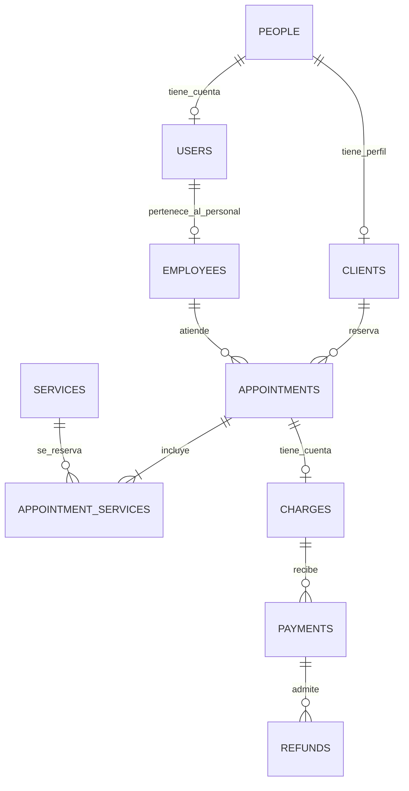
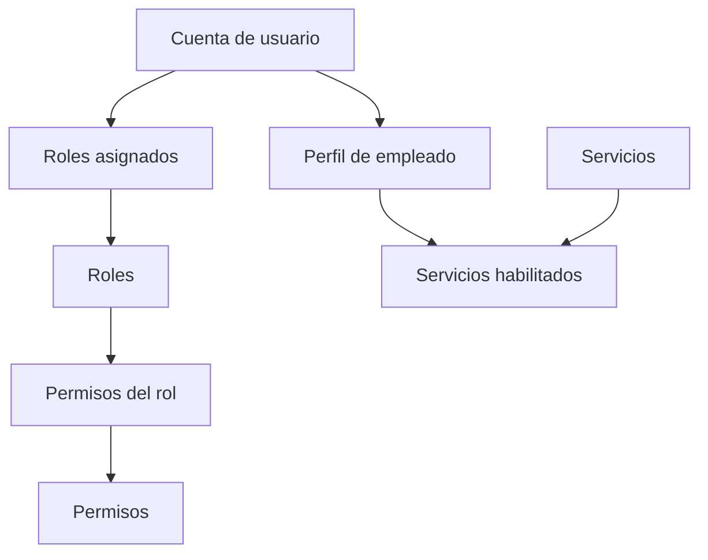
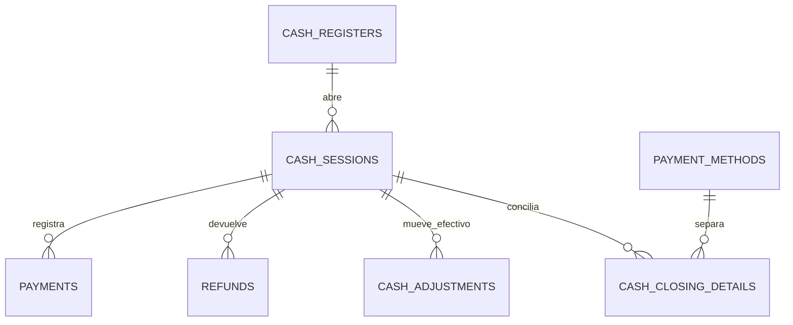
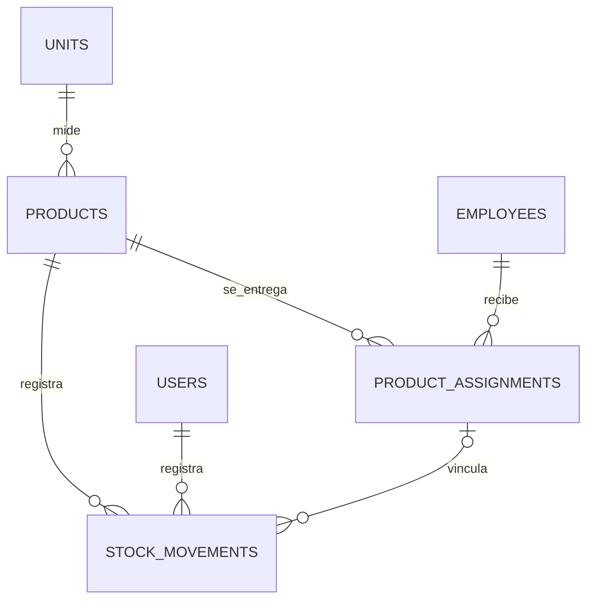

# Modelo de datos propuesto para MiliBrows Studio

Versión completa corregida para revisión. Fecha de revisión: 27 de octubre de 2026.

Este documento define el modelo lógico y propone tipos físicos para MySQL. Se basa en el informe compartido en la conversación, el avance de requerimientos y las aclaraciones posteriores. Conserva el diseño de referencia para el sistema final y distingue el alcance reducido del prototipo actual. No representa migraciones ejecutadas.

## Decisiones que sostienen el modelo

| Aspecto | Base del diseño |
|---|---|
| Plataforma final | Portal de clientes y panel interno, con entradas y compilaciones independientes desde un mismo proyecto React, y futura aplicación móvil exclusiva para clientes. Comparten una API Laravel y una base MySQL. |
| Personas y cuentas | Una persona puede ser cliente sin cuenta. El diseño final conserva una relación de roles por cuenta como propuesta flexible; no obliga a asignar varios roles. El personal usa cuentas individuales. |
| Roles | Únicamente administrator, receptionist, stylist y client: administrador, recepcionista, estilista y cliente. Se elimina el rol de marketing. |
| Citas | Una cita incluye uno o varios servicios, todos realizados por una misma estilista. Se crea confirmed; otros estados: completed, cancelled y no_show. No se usa pending. |
| Atención | La estilista asignada completa la atención y puede cancelarla escribiendo un motivo obligatorio. |
| Disponibilidad | Horario inicial compartido de lunes a sábado, de 10:00 a 22:00. Se verifica que la misma estilista pueda realizar todos los servicios y que la suma de sus duraciones quepa íntegra en un tramo disponible. |
| Inventario final | Lo gestiona la administradora. Se entregan insumos a las estilistas; al agotarse, se registra el agotamiento y se entrega un reemplazo. No existe consumo ni relación de inventario por cita. Fuera del prototipo actual. |
| Catálogo | Público. Las operaciones internas se autorizan por rol y propiedad de los registros. |
| Cobros finales | Completar una atención y cobrar son operaciones independientes. Cobros y caja quedan fuera del prototipo actual. El precio del catálogo y el precio acordado por servicio se conservan. |

Las siguientes decisiones son propuestas de modelado que el negocio aún debe validar: los bloqueos por ausencias y los horarios excepcionales; las cuentas de cobro con adelantos, pagos parciales, pagos mixtos y devoluciones; los retiros y aportes de efectivo; las condiciones económicas de cancelación; un descuento promocional por cuenta de cobro y la asignación manual de promociones personalizadas. El diseño permite estas capacidades sin afirmar que todas ya estén aprobadas.

El alcance corresponde a un establecimiento. No presupone sucursales, almacenes múltiples, compras a proveedores, lotes, ventas minoristas de productos, facturación tributaria ni historia clínica. Estas funciones necesitarían requerimientos propios.

## Alcance del prototipo y evolución al sistema final

El prototipo se concentra en catálogo de servicios y estilistas, clientes, disponibilidad, reservas de uno o varios servicios con una misma estilista, agenda, reprogramación, cancelación con motivo, registro de atención o inasistencia e historial del cliente. El resumen interno muestra citas y estados; no presenta ingresos ni alertas de inventario. Los clientes registrados desde recepción pueden no tener cuenta.

- **Frontend primero:** un proyecto React con `src/client`, `src/admin` y `src/shared`, con dos entradas y compilaciones independientes. Se empieza con datos simulados aislados de las pantallas.
- **Acceso de demostración:** selector de rol y perfil, sin autenticación real. La selección del navegador no constituye un mecanismo de seguridad ni autoriza publicar datos reales.
- **Persistencia posterior del prototipo:** una API Laravel básica y SQLite, con datos de ejemplo. No implementar todavía el monolito modular completo ni todas las reglas avanzadas del diseño final.
- **Fuera de esta iteración:** cobros, caja e inventario. Sus entidades permanecen en este documento para la evolución futura; no crear sus pantallas, endpoints ni migraciones para el prototipo actual.
- **Para una etapa posterior:** autenticación real, invitaciones, segundo factor y aplicación móvil. Promociones, fidelización, mensajería automática, auditoría exhaustiva y soporte operativo avanzado requieren una iteración específica; su presencia en el diseño no obliga a desarrollarlos ahora.

Como reducción inicial para SQLite pueden usarse nueve entidades: `people`, `users`, `roles`, `clients`, `employees`, `services`, `employee_services`, `appointments` y `appointment_services`. En esa reducción, `users.role_id` puede representar un único rol de demostración y reemplazar provisionalmente a `user_roles`; especialidades, categorías y horarios pueden comenzar como configuración sencilla. Las tablas de eventos, permisos detallados y soporte no son obligatorias en esta fase. Esta reducción es independiente del diccionario final que sigue.

### Acceso previsto para el sistema final

Una sola tabla `users` sirve a los accesos del portal y del panel. El login público admite clientes; el del panel admite personal autorizado. El autorregistro público crea exclusivamente clientes. El personal es invitado por un administrador; no se autorregistra como empleado. El segundo factor es obligatorio para administradores y opcional para el resto del personal. La API verifica rol y propiedad de los registros en cada operación protegida, independientemente del dominio que la invoque. La app móvil solo ofrece funciones de cliente.

### Fidelización pendiente de especificación

El conteo de visitas se deriva únicamente de citas `completed`: una cita con varios servicios cuenta como una atención completada, no como varias visitas. Las citas canceladas o con inasistencia no cuentan. Este documento aún no define un programa completo de acumulación, recompensas y canjes; si se mantiene esa funcionalidad en el sistema final, deberán aprobarse sus reglas y modelarse sus entidades antes de implementarlo. Las tablas de promociones no equivalen a un programa de fidelización completo.

## Convenciones

- Nombres técnicos en inglés y snake_case, con descripción funcional en español. Las etiquetas de la interfaz se muestran en español.
- PK: clave primaria. FK: clave foránea. UQ: combinación única. NN: campo no nulo. NULL: valor opcional.
- Identificadores de negocio: BIGINT UNSIGNED autoincremental, excepto claves compuestas y tablas técnicas nativas.
- Dinero: DECIMAL(12,2). Cantidades de inventario: DECIMAL(14,3). No utilizar FLOAT para importes monetarios.
- Fechas de eventos: DATETIME(6) en UTC. Los horarios semanales usan TIME y weekday en la zona local configurada. La conversión a fechas de calendario se hace con la zona del negocio.
- Motor propuesto: InnoDB, juego de caracteres utf8mb4. Las columnas que se comparan o relacionan deben tener tipos, tamaños y colaciones compatibles. Los correos de acceso se normalizan de forma coherente antes de aplicar unicidad.
- Campos de catálogo se desactivan cuando dejan de usarse. Las citas, cobros, devoluciones y movimientos se conservan. No aplicar ON DELETE CASCADE desde clientes, usuarios, servicios o productos hacia su historial operativo.
- Salvo excepción expresa, las FKs de negocio se implementan con ON DELETE RESTRICT y ON UPDATE RESTRICT. Desactivar una cuenta no elimina su autoría histórica.
- Las tablas de relación de roles, permisos, especialidades y servicios usan PK compuesta. No requieren un id artificial adicional.
- Los registros históricos de eventos, movimientos, devoluciones y auditoría son de anexado. Las correcciones se documentan, no sobrescriben silenciosamente el pasado.
- Las columnas generadas se calculan en MySQL y no son editables desde el formulario. No todas las restricciones de varias filas pueden expresarse mediante CHECK.

## Relaciones centrales

Estos diagramas muestran relaciones seleccionadas. El diccionario especifica todas las FKs, claves compuestas y referencias documentales.

## Inventario de entidades

| Área | Tablas | Cantidad |
|---|---|---:|
| Identidad y acceso | `people`, `users`, `roles`, `permissions`, `user_roles`, `role_permissions`, `staff_invitations` | 7 |
| Clientes y personal | `clients`, `employees`, `specialties`, `employee_specialties` | 4 |
| Servicios | `service_categories`, `services`, `employee_services` | 3 |
| Horarios y disponibilidad | `business_settings`, `opening_hours`, `schedule_exceptions`, `schedule_exception_periods`, `staff_unavailability` | 5 |
| Promociones | `promotions`, `promotion_services`, `promotion_clients` | 3 |
| Agenda y atención | `appointments`, `appointment_services`, `appointment_events`, `appointment_notes` | 4 |
| Caja y pagos | `charges`, `payment_methods`, `cash_registers`, `cash_sessions`, `payments`, `refunds`, `cash_adjustments`, `cash_closing_details` | 8 |
| Inventario | `units`, `inventory_categories`, `products`, `product_assignments`, `stock_movements` | 5 |
| Notificaciones | `notifications`, `notification_attempts` | 2 |
| Privacidad y trazabilidad | `privacy_notices`, `consent_events`, `data_requests`, `audit_logs` | 4 |
| Soporte técnico | `sessions`, `password_reset_tokens`, `personal_access_tokens`, `backup_runs` | 4 |

45 tablas de negocio y 4 de soporte técnico: 49 entidades en total. Las entidades de soporte no implican que deban implementarse manualmente ni que todas sean necesarias para el prototipo.

## Diccionario completo de entidades

Cada campo aparece con su tipo propuesto, nulabilidad, valor inicial y función. Las listas de reglas distinguen restricciones de fila de validaciones entre registros.

## Identidad y acceso

### 1. Personas — `people`

Datos de identidad y contacto compartidos por el perfil de cliente y la cuenta del personal.

| Campo | Tipo MySQL propuesto | NULL | Valor inicial | Función / referencia |
|---|---|:---:|---|---|
| `id` | `BIGINT UNSIGNED` | No | Autoincremental | PK. Identificador interno. |
| `full_name` | `VARCHAR(160)` | No | — | Nombre completo de la persona. |
| `phone` | `VARCHAR(25)` | Sí | — | Teléfono de contacto con código de país cuando corresponda. |
| `contact_email` | `VARCHAR(254)` | Sí | — | Correo para comunicaciones. Puede diferir del correo de acceso. |
| `anonymized_at` | `DATETIME(6)` | Sí | — | Fecha de anonimización aprobada del perfil. |
| `created_at` | `DATETIME(6)` | No | Instante de creación | Fecha de creación en UTC. |
| `updated_at` | `DATETIME(6)` | No | Instante de modificación | Fecha de la última modificación en UTC. |

Clave primaria: `id`.

Índices de consulta: `(phone)`; `(full_name)`.

Reglas:

- No usar nombre, teléfono o correo de contacto como clave primaria ni vincular cuentas automáticamente por una coincidencia.
- Los contactos pueden compartirse. Solo el correo de acceso de users debe ser único.
- La anonimización se ejecuta conforme al procedimiento y conservación que defina el negocio. No borra indiscriminadamente los registros operativos.

### 2. Cuentas de acceso — `users`

Credenciales y configuración de autenticación de una persona.

| Campo | Tipo MySQL propuesto | NULL | Valor inicial | Función / referencia |
|---|---|:---:|---|---|
| `id` | `BIGINT UNSIGNED` | No | Autoincremental | PK. Identificador interno. |
| `person_id` | `BIGINT UNSIGNED` | No | — | Persona titular de la cuenta. FK → people.id. |
| `email` | `VARCHAR(254)` | No | — | Correo utilizado para iniciar sesión. Normalizado de forma consistente. |
| `password` | `VARCHAR(255)` | No | — | Hash de contraseña generado con Argon2id. Nunca contraseña en texto. |
| `email_verified_at` | `DATETIME(6)` | Sí | — | Fecha de verificación del correo. |
| `is_active` | `BOOLEAN` | No | TRUE | Permite o bloquea el acceso a la cuenta. |
| `remember_token` | `VARCHAR(100)` | Sí | — | Token de recordar sesión gestionado por Laravel. |
| `two_factor_secret` | `TEXT` | Sí | — | Secreto del segundo factor, cifrado por la aplicación. |
| `two_factor_recovery_codes` | `TEXT` | Sí | — | Códigos de recuperación protegidos mediante cifrado de la aplicación. |
| `two_factor_confirmed_at` | `DATETIME(6)` | Sí | — | Confirmación de la configuración del segundo factor. |
| `last_login_at` | `DATETIME(6)` | Sí | — | Último acceso exitoso. |
| `created_at` | `DATETIME(6)` | No | Instante de creación | Fecha de creación en UTC. |
| `updated_at` | `DATETIME(6)` | No | Instante de modificación | Fecha de la última modificación en UTC. |

Clave primaria: `id`.

Restricciones únicas: `(person_id)`; `(email)`.

Reglas:

- Una persona puede tener como máximo una cuenta en esta propuesta. Los diferentes accesos se resuelven con roles.
- La cuenta de un cliente se vincula a people; su perfil de clients conserva el mismo person_id.
- En el sistema final, la API exige two_factor_confirmed_at y segundo factor verificado para operaciones administrativas; disponer de columnas TOTP no aplica esa obligación por sí solo. El resto del personal puede habilitarlo de forma opcional.
- Argon2id protege contraseñas. Los secretos TOTP necesitan cifrado reversible controlado; no se tratan como contraseñas.

### 3. Roles — `roles`

Responsabilidades generales de acceso.

| Campo | Tipo MySQL propuesto | NULL | Valor inicial | Función / referencia |
|---|---|:---:|---|---|
| `id` | `BIGINT UNSIGNED` | No | Autoincremental | PK. Identificador interno. |
| `code` | `VARCHAR(40)` | No | — | Código estable: administrator, receptionist, stylist o client. No existe el rol marketing. |
| `name` | `VARCHAR(80)` | No | — | Nombre mostrado en la interfaz. |
| `description` | `VARCHAR(255)` | Sí | — | Responsabilidades generales. |
| `is_active` | `BOOLEAN` | No | TRUE | Habilitación del rol. |
| `created_at` | `DATETIME(6)` | No | Instante de creación | Fecha de creación en UTC. |
| `updated_at` | `DATETIME(6)` | No | Instante de modificación | Fecha de la última modificación en UTC. |

Clave primaria: `id`.

Restricciones únicas: `(code)`.

Reglas:

- No crear una cuenta compartida para inventario. Asignar el permiso correspondiente a la cuenta personal de la administradora.

### 4. Permisos — `permissions`

Acciones autorizables independientemente del nombre del rol.

| Campo | Tipo MySQL propuesto | NULL | Valor inicial | Función / referencia |
|---|---|:---:|---|---|
| `id` | `BIGINT UNSIGNED` | No | Autoincremental | PK. Identificador interno. |
| `code` | `VARCHAR(100)` | No | — | Código como appointments.view_own, appointments.manage_all o inventory.manage. |
| `name` | `VARCHAR(120)` | No | — | Descripción breve del permiso. |
| `module` | `VARCHAR(50)` | No | — | Área funcional del permiso. |
| `created_at` | `DATETIME(6)` | No | Instante de creación | Fecha de creación en UTC. |
| `updated_at` | `DATETIME(6)` | No | Instante de modificación | Fecha de la última modificación en UTC. |

Clave primaria: `id`.

Restricciones únicas: `(code)`.

### 5. Roles asignados a cuentas — `user_roles`

Relación muchos a muchos entre cuentas y roles.

| Campo | Tipo MySQL propuesto | NULL | Valor inicial | Función / referencia |
|---|---|:---:|---|---|
| `user_id` | `BIGINT UNSIGNED` | No | — | PK. Cuenta beneficiaria. FK → users.id. |
| `role_id` | `BIGINT UNSIGNED` | No | — | PK. Rol asignado. FK → roles.id. |
| `assigned_by_id` | `BIGINT UNSIGNED` | Sí | — | Cuenta que asignó el rol. NULL para una carga inicial controlada. FK → users.id. |
| `created_at` | `DATETIME(6)` | No | Instante de creación | Fecha de creación en UTC. |
| `updated_at` | `DATETIME(6)` | No | Instante de modificación | Fecha de la última modificación en UTC. |

Clave primaria: `user_id`, `role_id`.

Índices de consulta: `(role_id)`.

Reglas:

- La combinación user_id y role_id no puede repetirse. Toda revocación se registra en auditoría.

### 6. Permisos de roles — `role_permissions`

Relación muchos a muchos entre roles y permisos.

| Campo | Tipo MySQL propuesto | NULL | Valor inicial | Función / referencia |
|---|---|:---:|---|---|
| `role_id` | `BIGINT UNSIGNED` | No | — | PK. Rol configurado. FK → roles.id. |
| `permission_id` | `BIGINT UNSIGNED` | No | — | PK. Acción concedida. FK → permissions.id. |
| `created_at` | `DATETIME(6)` | No | Instante de creación | Fecha de creación en UTC. |
| `updated_at` | `DATETIME(6)` | No | Instante de modificación | Fecha de la última modificación en UTC. |

Clave primaria: `role_id`, `permission_id`.

Índices de consulta: `(permission_id)`.

### 7. Invitaciones al personal — `staff_invitations`

Invitaciones creadas por administración para el alta controlada de cuentas del personal en el sistema final. No se implementan en la demostración sin autenticación.

| Campo | Tipo MySQL propuesto | NULL | Valor inicial | Función / referencia |
|---|---|:---:|---|---|
| `id` | `BIGINT UNSIGNED` | No | Autoincremental | PK. Identificador. |
| `email` | `VARCHAR(254)` | No | — | Correo invitado, normalizado como users.email. |
| `full_name` | `VARCHAR(160)` | No | — | Nombre previsto para el perfil. |
| `role_id` | `BIGINT UNSIGNED` | No | — | Rol de personal que se asignará al aceptar. FK → roles.id. |
| `token_hash` | `CHAR(64)` | No | — | Resumen del token aleatorio de invitación; no almacenar el token en claro. |
| `invited_by_id` | `BIGINT UNSIGNED` | No | — | Administrador que invita. FK → users.id. |
| `expires_at` | `DATETIME(6)` | No | — | Fecha límite de aceptación. |
| `accepted_at` | `DATETIME(6)` | Sí | — | Aceptación exitosa. |
| `accepted_user_id` | `BIGINT UNSIGNED` | Sí | — | Cuenta vinculada al aceptar. FK → users.id. |
| `revoked_at` | `DATETIME(6)` | Sí | — | Revocación de invitación no aceptada. |
| `revoked_by_id` | `BIGINT UNSIGNED` | Sí | — | Administrador que revoca. FK → users.id. |
| `created_at` | `DATETIME(6)` | No | Instante de creación | Fecha en UTC. |
| `updated_at` | `DATETIME(6)` | No | Instante de modificación | Fecha en UTC. |

Clave primaria: `id`.

Restricciones únicas: `(token_hash)`.

Índices de consulta: `(email, expires_at)`.

Reglas:

- Roles permitidos: administrator, receptionist o stylist. El alta pública solo concede client y no acepta un rol enviado libremente por el formulario.
- Un token válido, no vencido, no revocado y no usado se acepta una sola vez dentro de una transacción. La aceptación crea persona, cuenta, rol y perfil de personal, o enlaza una cuenta existente tras comprobar su titularidad.
- Coincidir por correo no acredita titularidad para elevar una cuenta existente: exigir autenticación de esa cuenta. No sustituir su contraseña desde una invitación.
- accepted_at y accepted_user_id se informan juntos; revoked_at y revoked_by_id también. No puede estar aceptada y revocada simultáneamente.
- La aceptación no omite el segundo factor obligatorio de una cuenta administradora. Renovar una invitación invalida la anterior; no cambia retroactivamente su historial.

## Clientes y personal

### 8. Clientes — `clients`

Perfil de cliente independiente de la existencia de una cuenta de acceso.

| Campo | Tipo MySQL propuesto | NULL | Valor inicial | Función / referencia |
|---|---|:---:|---|---|
| `id` | `BIGINT UNSIGNED` | No | Autoincremental | PK. Identificador interno. |
| `person_id` | `BIGINT UNSIGNED` | No | — | Persona atendida. FK → people.id. |
| `preferences` | `TEXT` | Sí | — | Preferencias declaradas relevantes para la atención. |
| `is_active` | `BOOLEAN` | No | TRUE | Habilitación del perfil para nuevas operaciones. |
| `created_by_id` | `BIGINT UNSIGNED` | Sí | — | Cuenta que registró al cliente. Puede quedar vacía durante el alta pública inicial. FK → users.id. |
| `created_at` | `DATETIME(6)` | No | Instante de creación | Fecha de creación en UTC. |
| `updated_at` | `DATETIME(6)` | No | Instante de modificación | Fecha de la última modificación en UTC. |

Clave primaria: `id`.

Restricciones únicas: `(person_id)`.

Reglas:

- Recepción puede crear people y clients sin crear users.
- El autorregistro crea persona, cuenta y perfil de cliente en una sola transacción.
- No crear una segunda tabla que copie todo el historial: se consulta desde appointments completadas y appointment_notes.

### 9. Personal — `employees`

Perfil laboral de una cuenta del personal.

| Campo | Tipo MySQL propuesto | NULL | Valor inicial | Función / referencia |
|---|---|:---:|---|---|
| `id` | `BIGINT UNSIGNED` | No | Autoincremental | PK. Identificador interno. |
| `user_id` | `BIGINT UNSIGNED` | No | — | Cuenta individual del empleado. FK → users.id. |
| `position` | `VARCHAR(80)` | No | — | Cargo o función en el negocio. |
| `biography` | `TEXT` | Sí | — | Presentación de la estilista para el catálogo cuando corresponda. |
| `is_bookable` | `BOOLEAN` | No | FALSE | Indica si puede recibir citas como estilista. |
| `is_active` | `BOOLEAN` | No | TRUE | Habilitación del empleado. |
| `created_at` | `DATETIME(6)` | No | Instante de creación | Fecha de creación en UTC. |
| `updated_at` | `DATETIME(6)` | No | Instante de modificación | Fecha de la última modificación en UTC. |

Clave primaria: `id`.

Restricciones únicas: `(user_id)`.

Reglas:

- Cada estilista dispone de su propia cuenta. Los datos personales se obtienen a través de users.person_id.
- Ser reservable y estar activo no sustituye la comprobación de permisos ni la habilitación para el servicio.

### 10. Especialidades — `specialties`

Catálogo de especialidades de las estilistas.

| Campo | Tipo MySQL propuesto | NULL | Valor inicial | Función / referencia |
|---|---|:---:|---|---|
| `id` | `BIGINT UNSIGNED` | No | Autoincremental | PK. Identificador interno. |
| `name` | `VARCHAR(100)` | No | — | Nombre de la especialidad. |
| `description` | `TEXT` | Sí | — | Descripción. |
| `is_active` | `BOOLEAN` | No | TRUE | Habilitación de la especialidad. |
| `created_at` | `DATETIME(6)` | No | Instante de creación | Fecha de creación en UTC. |
| `updated_at` | `DATETIME(6)` | No | Instante de modificación | Fecha de la última modificación en UTC. |

Clave primaria: `id`.

Restricciones únicas: `(name)`.

### 11. Especialidades del personal — `employee_specialties`

Relación muchos a muchos entre personal y especialidades.

| Campo | Tipo MySQL propuesto | NULL | Valor inicial | Función / referencia |
|---|---|:---:|---|---|
| `employee_id` | `BIGINT UNSIGNED` | No | — | PK. Estilista. FK → employees.id. |
| `specialty_id` | `BIGINT UNSIGNED` | No | — | PK. Especialidad. FK → specialties.id. |
| `created_at` | `DATETIME(6)` | No | Instante de creación | Fecha de creación en UTC. |
| `updated_at` | `DATETIME(6)` | No | Instante de modificación | Fecha de la última modificación en UTC. |

Clave primaria: `employee_id`, `specialty_id`.

Índices de consulta: `(specialty_id)`.

## Servicios

### 12. Categorías de servicios — `service_categories`

Agrupación del catálogo público e interno.

| Campo | Tipo MySQL propuesto | NULL | Valor inicial | Función / referencia |
|---|---|:---:|---|---|
| `id` | `BIGINT UNSIGNED` | No | Autoincremental | PK. Identificador interno. |
| `name` | `VARCHAR(100)` | No | — | Nombre de la categoría. |
| `description` | `TEXT` | Sí | — | Descripción. |
| `display_order` | `SMALLINT UNSIGNED` | No | 0 | Orden de presentación. |
| `is_active` | `BOOLEAN` | No | TRUE | Habilitación de la categoría. |
| `created_at` | `DATETIME(6)` | No | Instante de creación | Fecha de creación en UTC. |
| `updated_at` | `DATETIME(6)` | No | Instante de modificación | Fecha de la última modificación en UTC. |

Clave primaria: `id`.

Restricciones únicas: `(name)`.

### 13. Servicios — `services`

Servicios ofrecidos y sus valores vigentes.

| Campo | Tipo MySQL propuesto | NULL | Valor inicial | Función / referencia |
|---|---|:---:|---|---|
| `id` | `BIGINT UNSIGNED` | No | Autoincremental | PK. Identificador interno. |
| `category_id` | `BIGINT UNSIGNED` | No | — | Categoría del servicio. FK → service_categories.id. |
| `code` | `VARCHAR(30)` | No | — | Código interno estable. |
| `name` | `VARCHAR(140)` | No | — | Nombre comercial. |
| `description` | `TEXT` | Sí | — | Descripción pública. |
| `price` | `DECIMAL(12,2)` | No | — | Precio vigente del servicio. |
| `duration_minutes` | `SMALLINT UNSIGNED` | No | — | Duración estándar usada para reservar la agenda. |
| `image_path` | `VARCHAR(255)` | Sí | — | Ruta de una imagen del catálogo, si se utiliza. |
| `is_public` | `BOOLEAN` | No | TRUE | Visibilidad en la página pública. |
| `is_active` | `BOOLEAN` | No | TRUE | Habilitación para nuevas reservas. |
| `created_at` | `DATETIME(6)` | No | Instante de creación | Fecha de creación en UTC. |
| `updated_at` | `DATETIME(6)` | No | Instante de modificación | Fecha de la última modificación en UTC. |

Clave primaria: `id`.

Restricciones únicas: `(code)`.

Índices de consulta: `(category_id, is_active, is_public)`.

Reglas:

- CHECK price >= 0 y duration_minutes > 0.
- Modificar precio o duración no debe alterar los valores históricos guardados en citas ya creadas.

### 14. Servicios habilitados por estilista — `employee_services`

Relación muchos a muchos entre empleados y servicios.

| Campo | Tipo MySQL propuesto | NULL | Valor inicial | Función / referencia |
|---|---|:---:|---|---|
| `employee_id` | `BIGINT UNSIGNED` | No | — | PK. Estilista habilitado. FK → employees.id. |
| `service_id` | `BIGINT UNSIGNED` | No | — | PK. Servicio que puede realizar. FK → services.id. |
| `is_active` | `BOOLEAN` | No | TRUE | Vigencia de la habilitación. |
| `created_at` | `DATETIME(6)` | No | Instante de creación | Fecha de creación en UTC. |
| `updated_at` | `DATETIME(6)` | No | Instante de modificación | Fecha de la última modificación en UTC. |

Clave primaria: `employee_id`, `service_id`.

Índices de consulta: `(service_id, is_active)`.

Reglas:

- Cada servicio del detalle de una cita debe estar habilitado para la estilista de su cabecera. La comprobación cruza appointments, appointment_services y employee_services y se realiza en la transacción de reserva; no se representa con una FK compuesta inexistente en appointments.
- Una habilitación utilizada se desactiva en lugar de eliminarse. El modelo usa una duración común por servicio, sin sobrescritura individual.

## Horarios y disponibilidad

### 15. Configuración del establecimiento — `business_settings`

Configuración del único establecimiento incluido en el alcance.

| Campo | Tipo MySQL propuesto | NULL | Valor inicial | Función / referencia |
|---|---|:---:|---|---|
| `id` | `TINYINT UNSIGNED` | No | 1 | PK. Fila única del establecimiento. |
| `business_name` | `VARCHAR(160)` | No | — | Nombre comercial. |
| `phone` | `VARCHAR(25)` | Sí | — | Teléfono público. |
| `email` | `VARCHAR(254)` | Sí | — | Correo público. |
| `address` | `VARCHAR(255)` | Sí | — | Dirección pública. |
| `timezone` | `VARCHAR(64)` | No | America/Lima, propuesto | Zona horaria IANA del negocio. |
| `currency` | `CHAR(3)` | No | PEN, propuesto | Moneda de las operaciones. |
| `reminder_lead_minutes` | `INT UNSIGNED` | Sí | — | Anticipación de recordatorios. Se configura antes de habilitar el envío. |
| `cancellation_policy` | `TEXT` | Sí | — | Política que el negocio apruebe para cancelaciones y reprogramaciones. |
| `created_at` | `DATETIME(6)` | No | Instante de creación | Fecha de creación en UTC. |
| `updated_at` | `DATETIME(6)` | No | Instante de modificación | Fecha de la última modificación en UTC. |

Clave primaria: `id`.

Reglas:

- CHECK id = 1. No se agregan sucursales al alcance actual.
- La anticipación del recordatorio y las condiciones de cancelación están pendientes de validación; no se fija un valor arbitrario.

### 16. Tramos del horario general — `opening_hours`

Horario semanal compartido por las estilistas.

| Campo | Tipo MySQL propuesto | NULL | Valor inicial | Función / referencia |
|---|---|:---:|---|---|
| `id` | `BIGINT UNSIGNED` | No | Autoincremental | PK. Identificador interno. |
| `weekday` | `TINYINT UNSIGNED` | No | — | Día ISO: 1 lunes a 7 domingo. |
| `start_time` | `TIME` | No | — | Inicio del tramo, en hora local del negocio. |
| `end_time` | `TIME` | No | — | Fin del tramo, en hora local. |
| `is_active` | `BOOLEAN` | No | TRUE | Vigencia del tramo. |
| `created_at` | `DATETIME(6)` | No | Instante de creación | Fecha de creación en UTC. |
| `updated_at` | `DATETIME(6)` | No | Instante de modificación | Fecha de la última modificación en UTC. |

Clave primaria: `id`.

Restricciones únicas: `(weekday, start_time)`.

Reglas:

- CHECK weekday BETWEEN 1 AND 7 y end_time > start_time.
- Puede haber varios tramos por día para representar descansos generales. El backend impide tramos superpuestos.
- Para el prototipo, cargar lunes a sábado de 10:00 a 22:00, con domingo cerrado. La configuración permite cambiar ese horario posteriormente.

### 17. Excepciones por fecha — `schedule_exceptions`

Cierre o reemplazo del horario general para una fecha concreta.

| Campo | Tipo MySQL propuesto | NULL | Valor inicial | Función / referencia |
|---|---|:---:|---|---|
| `id` | `BIGINT UNSIGNED` | No | Autoincremental | PK. Identificador interno. |
| `date` | `DATE` | No | — | Fecha local de la excepción. |
| `is_closed` | `BOOLEAN` | No | — | TRUE para cierre completo. |
| `reason` | `VARCHAR(255)` | No | — | Motivo de la excepción. |
| `created_by_id` | `BIGINT UNSIGNED` | No | — | Cuenta responsable. FK → users.id. |
| `created_at` | `DATETIME(6)` | No | Instante de creación | Fecha de creación en UTC. |
| `updated_at` | `DATETIME(6)` | No | Instante de modificación | Fecha de la última modificación en UTC. |

Clave primaria: `id`.

Restricciones únicas: `(date)`.

Reglas:

- Un día cerrado no tiene tramos de excepción. Un día con horario especial necesita al menos un tramo.
- Las excepciones reemplazan el horario semanal de esa fecha.

### 18. Tramos del horario excepcional — `schedule_exception_periods`

Intervalos de apertura de una excepción que no es un cierre.

| Campo | Tipo MySQL propuesto | NULL | Valor inicial | Función / referencia |
|---|---|:---:|---|---|
| `id` | `BIGINT UNSIGNED` | No | Autoincremental | PK. Identificador interno. |
| `exception_id` | `BIGINT UNSIGNED` | No | — | Excepción a la que pertenece. FK → schedule_exceptions.id. |
| `start_time` | `TIME` | No | — | Inicio local del tramo. |
| `end_time` | `TIME` | No | — | Fin local del tramo. |
| `created_at` | `DATETIME(6)` | No | Instante de creación | Fecha de creación en UTC. |
| `updated_at` | `DATETIME(6)` | No | Instante de modificación | Fecha de la última modificación en UTC. |

Clave primaria: `id`.

Restricciones únicas: `(exception_id, start_time)`.

Reglas:

- CHECK end_time > start_time. Los tramos de una misma excepción no pueden superponerse.

### 19. Bloqueos de agenda — `staff_unavailability`

Ausencias o bloqueos puntuales de una estilista sin crear un horario individual permanente.

| Campo | Tipo MySQL propuesto | NULL | Valor inicial | Función / referencia |
|---|---|:---:|---|---|
| `id` | `BIGINT UNSIGNED` | No | Autoincremental | PK. Identificador interno. |
| `employee_id` | `BIGINT UNSIGNED` | No | — | Estilista no disponible. FK → employees.id. |
| `starts_at` | `DATETIME(6)` | No | — | Inicio del bloqueo en UTC. |
| `ends_at` | `DATETIME(6)` | No | — | Fin del bloqueo en UTC. |
| `reason` | `VARCHAR(255)` | No | — | Motivo del bloqueo. |
| `created_by_id` | `BIGINT UNSIGNED` | No | — | Cuenta que registró el bloqueo. FK → users.id. |
| `revoked_at` | `DATETIME(6)` | Sí | — | Revocación del bloqueo, conservando su historial. |
| `revoked_by_id` | `BIGINT UNSIGNED` | Sí | — | Cuenta que revocó el bloqueo. FK → users.id. |
| `created_at` | `DATETIME(6)` | No | Instante de creación | Fecha de creación en UTC. |
| `updated_at` | `DATETIME(6)` | No | Instante de modificación | Fecha de la última modificación en UTC. |

Clave primaria: `id`.

Índices de consulta: `(employee_id, starts_at, ends_at)`.

Reglas:

- CHECK ends_at > starts_at. Los bloqueos vigentes intervienen en el cálculo de disponibilidad.
- Incorporar un bloqueo no cancela citas automáticamente: el personal debe resolver las citas afectadas.
- Esta extensión se propone para cubrir ausencias reales; todavía no fue definida expresamente por el negocio.

## Promociones

### 20. Promociones — `promotions`

Condiciones de un descuento público o asignado a clientes.

| Campo | Tipo MySQL propuesto | NULL | Valor inicial | Función / referencia |
|---|---|:---:|---|---|
| `id` | `BIGINT UNSIGNED` | No | Autoincremental | PK. Identificador interno. |
| `name` | `VARCHAR(140)` | No | — | Nombre comercial. |
| `description` | `TEXT` | Sí | — | Descripción y condiciones. |
| `discount_type` | `VARCHAR(20)` | No | — | percentage o fixed_amount. |
| `discount_value` | `DECIMAL(12,2)` | No | — | Porcentaje o importe según el tipo de descuento. |
| `audience` | `VARCHAR(20)` | No | — | public o assigned_clients. |
| `starts_at` | `DATETIME(6)` | No | — | Inicio de vigencia en UTC. |
| `ends_at` | `DATETIME(6)` | No | — | Fin de vigencia en UTC. |
| `is_active` | `BOOLEAN` | No | TRUE | Habilitación de la promoción. |
| `created_by_id` | `BIGINT UNSIGNED` | No | — | Cuenta responsable. FK → users.id. |
| `created_at` | `DATETIME(6)` | No | Instante de creación | Fecha de creación en UTC. |
| `updated_at` | `DATETIME(6)` | No | Instante de modificación | Fecha de la última modificación en UTC. |

Clave primaria: `id`.

Índices de consulta: `(is_active, starts_at, ends_at)`.

Reglas:

- CHECK ends_at > starts_at y discount_value > 0; para percentage, discount_value <= 100.
- Cada promoción debe tener al menos un servicio asociado. No se interpreta una lista vacía como todos los servicios.
- Se propone un solo descuento promocional por cuenta de cobro. La acumulación no está aprobada. Si una cita tiene servicios no incluidos en la promoción, el descuento solo se calcula sobre la parte elegible; un descuento fijo no puede superar esa base elegible.

### 21. Servicios incluidos en promociones — `promotion_services`

Aplicación de promociones a servicios.

| Campo | Tipo MySQL propuesto | NULL | Valor inicial | Función / referencia |
|---|---|:---:|---|---|
| `promotion_id` | `BIGINT UNSIGNED` | No | — | PK. Promoción. FK → promotions.id. |
| `service_id` | `BIGINT UNSIGNED` | No | — | PK. Servicio incluido. FK → services.id. |
| `created_at` | `DATETIME(6)` | No | Instante de creación | Fecha de creación en UTC. |
| `updated_at` | `DATETIME(6)` | No | Instante de modificación | Fecha de la última modificación en UTC. |

Clave primaria: `promotion_id`, `service_id`.

Índices de consulta: `(service_id)`.

### 22. Promociones asignadas a clientes — `promotion_clients`

Asignaciones explícitas para promociones personalizadas.

| Campo | Tipo MySQL propuesto | NULL | Valor inicial | Función / referencia |
|---|---|:---:|---|---|
| `promotion_id` | `BIGINT UNSIGNED` | No | — | PK. Promoción personalizada. FK → promotions.id. |
| `client_id` | `BIGINT UNSIGNED` | No | — | PK. Cliente beneficiario. FK → clients.id. |
| `assigned_by_id` | `BIGINT UNSIGNED` | No | — | Cuenta que hizo la asignación. FK → users.id. |
| `revoked_at` | `DATETIME(6)` | Sí | — | Revocación de la asignación. |
| `created_at` | `DATETIME(6)` | No | Instante de creación | Fecha de creación en UTC. |
| `updated_at` | `DATETIME(6)` | No | Instante de modificación | Fecha de la última modificación en UTC. |

Clave primaria: `promotion_id`, `client_id`.

Índices de consulta: `(client_id)`.

Reglas:

- La personalización se resuelve inicialmente con asignaciones explícitas; no presupone un algoritmo de recomendaciones.

## Agenda y atención

### 23. Citas y atenciones — `appointments`

Cabecera de una reserva para un cliente y una sola estilista. Sus servicios se almacenan en `appointment_services`; no existe `service_id` en esta cabecera.

| Campo | Tipo MySQL propuesto | NULL | Valor inicial | Función / referencia |
|---|---|:---:|---|---|
| `id` | `BIGINT UNSIGNED` | No | Autoincremental | PK. Identificador interno. |
| `code` | `VARCHAR(30)` | No | — | Referencia pública; no sustituye los permisos. |
| `client_id` | `BIGINT UNSIGNED` | No | — | Cliente de la cita. FK → clients.id. |
| `employee_id` | `BIGINT UNSIGNED` | No | — | Única estilista de todos los servicios. FK → employees.id. |
| `starts_at` | `DATETIME(6)` | No | — | Inicio reservado en UTC. |
| `ends_at` | `DATETIME(6)` | No | — | Fin calculado a partir de la suma de duraciones acordadas. |
| `status` | `VARCHAR(20)` | No | confirmed | confirmed, completed, cancelled o no_show. |
| `source` | `VARCHAR(20)` | No | — | web, mobile o reception. |
| `observations` | `TEXT` | Sí | — | Observaciones generales de la reserva. |
| `revision` | `INT UNSIGNED` | No | 1 | Versión para controlar cambios simultáneos. |
| `created_by_id` | `BIGINT UNSIGNED` | No | — | Cuenta que reservó. FK → users.id. |
| `completed_at` | `DATETIME(6)` | Sí | — | Momento de finalización de la atención. |
| `completed_by_id` | `BIGINT UNSIGNED` | Sí | — | Cuenta responsable. FK → users.id. |
| `cancelled_at` | `DATETIME(6)` | Sí | — | Momento de cancelación. |
| `cancelled_by_id` | `BIGINT UNSIGNED` | Sí | — | Cuenta que canceló. FK → users.id. |
| `cancellation_reason` | `TEXT` | Sí | — | Obligatorio para cancelaciones del personal; opcional para el cliente según la política aprobada. |
| `no_show_at` | `DATETIME(6)` | Sí | — | Momento en que se registró la inasistencia. |
| `no_show_by_id` | `BIGINT UNSIGNED` | Sí | — | Cuenta que registró la inasistencia. FK → users.id. |
| `created_at` | `DATETIME(6)` | No | Instante de creación | Fecha en UTC. |
| `updated_at` | `DATETIME(6)` | No | Instante de modificación | Fecha en UTC. |

Clave primaria: `id`.

Restricciones únicas: `(code)`.

Índices de consulta: `(employee_id, starts_at, ends_at)`; `(client_id, starts_at)`; `(status, starts_at)`.

Reglas:

- Una cita contiene al menos un servicio. Todos los servicios corresponden a la misma estilista de appointments.employee_id; el detalle no asigna otra estilista.
- CHECK ends_at > starts_at y revision >= 1; restringir status a los cuatro valores definidos. Estado como atributo: no se necesita una tabla de estados de cita.
- Duración total = SUM(appointment_services.duration_minutes); precio acordado total = SUM(appointment_services.quoted_price). El backend calcula ends_at = starts_at + duración total. Estas sumas entre filas no se implementan mediante CHECK ni columna generada de una sola fila.
- Conservar las instantáneas de cada servicio. Un cambio posterior del catálogo no modifica una reserva ya acordada. Reprogramar solo el horario conserva los precios y duraciones; cambiar los servicios requiere recalcular y validar el intervalo en la misma transacción.
- La cita nace confirmed. Puede pasar a completed, cancelled o no_show; en este alcance no se reabre automáticamente una cita terminada. La estilista asignada completa la atención. La inasistencia la registra personal autorizado cuando ya pasó el inicio reservado, nunca automáticamente por no haber un pago.
- Cada estado terminal exige su fecha y autor y deja vacíos los datos de los otros estados terminales. En confirmed están vacíos los tres grupos. Cancelar por parte del personal exige motivo no vacío.
- Recepción o administración pueden reservar para clientes sin cuenta y registrar atenciones sin reserva previa; created_by_id es la cuenta del personal, no una cuenta ficticia del cliente.
- Reprogramar conserva id e incrementa revision. En el diseño final, cada cambio genera appointment_events en la misma transacción. El prototipo puede omitir esa bitácora extensa y conservar estado, fechas y motivo esenciales.
- El intervalo completo debe caber en el horario y no cruzarse con otra cita de la misma estilista. No se fracciona automáticamente una cita en varias atenciones con estilistas distintas.

### 24. Servicios de la cita — `appointment_services`

Detalle de los servicios acordados. Permite uno o varios servicios por cita sin repetir su cabecera.

| Campo | Tipo MySQL propuesto | NULL | Valor inicial | Función / referencia |
|---|---|:---:|---|---|
| `id` | `BIGINT UNSIGNED` | No | Autoincremental | PK. Identificador del detalle. |
| `appointment_id` | `BIGINT UNSIGNED` | No | — | Cita a la que pertenece. FK → appointments.id. |
| `service_id` | `BIGINT UNSIGNED` | No | — | Servicio reservado. FK → services.id. |
| `position` | `SMALLINT UNSIGNED` | No | — | Orden del servicio dentro de la cita, desde 1. |
| `service_name_snapshot` | `VARCHAR(140)` | No | — | Nombre acordado al reservar. |
| `duration_minutes` | `SMALLINT UNSIGNED` | No | — | Duración acordada de este servicio. |
| `quoted_price` | `DECIMAL(12,2)` | No | — | Precio acordado de este servicio, en soles. No acredita pago. |
| `created_at` | `DATETIME(6)` | No | Instante de creación | Fecha en UTC. |
| `updated_at` | `DATETIME(6)` | No | Instante de modificación | Fecha en UTC. |

Clave primaria: `id`.

Restricciones únicas: `(appointment_id, position)`.

Índices de consulta: `(service_id)`.

Reglas:

- CHECK position > 0, duration_minutes > 0 y quoted_price >= 0.
- No tiene estado, horario ni estilista independientes: la agenda utiliza el intervalo y el estado de la cabecera.
- Al reservar o modificar el detalle, comprobar que cada servicio y su habilitación para la estilista estén activos. La conservación de una cita histórica no depende de que el catálogo siga activo.
- Crear cabecera y detalles de forma atómica. No confirmar una reserva sin servicios. La regla de al menos una fila requiere validación transaccional.
- Se propone no repetir un mismo servicio en el formulario inicial. La unicidad física es por posición; una restricción adicional por servicio queda sujeta a que el negocio confirme esa limitación.

### 25. Historial de cambios de citas — `appointment_events`

Bitácora del diseño final: secuencia inmutable de creación, reprogramación, modificación de servicios, finalización, cancelación o inasistencia. Se puede omitir en el prototipo acotado; no es un catálogo de estados.

| Campo | Tipo MySQL propuesto | NULL | Valor inicial | Función / referencia |
|---|---|:---:|---|---|
| `id` | `BIGINT UNSIGNED` | No | Autoincremental | PK. Identificador interno. |
| `appointment_id` | `BIGINT UNSIGNED` | No | — | Cita afectada. FK → appointments.id. |
| `revision` | `INT UNSIGNED` | No | — | Versión resultante de la cita. |
| `event_type` | `VARCHAR(30)` | No | — | created, rescheduled, completed, cancelled, no_show o updated. |
| `actor_user_id` | `BIGINT UNSIGNED` | Sí | — | Cuenta responsable. NULL si es una acción automática identificada. FK → users.id. |
| `changes` | `JSON` | No | — | Valores anteriores y nuevos de los campos modificados. No guarda credenciales. |
| `reason` | `TEXT` | Sí | — | Motivo del cambio o de la cancelación. |
| `created_at` | `DATETIME(6)` | No | Instante de creación | Fecha de creación en UTC. |

Clave primaria: `id`.

Restricciones únicas: `(appointment_id, revision)`.

Índices de consulta: `(appointment_id, created_at)`.

Reglas:

- Solo anexar eventos. Los identificadores históricos dentro de changes son instantáneas documentales, no FKs.
- El motivo y el actor se escriben junto al cambio de la cita. changes puede incluir las instantáneas anteriores y nuevas de sus servicios; no se crea otra bitácora separada para los estados.

### 26. Notas de atención — `appointment_notes`

Información registrada sobre la atención realizada; una ficha por cita.

| Campo | Tipo MySQL propuesto | NULL | Valor inicial | Función / referencia |
|---|---|:---:|---|---|
| `appointment_id` | `BIGINT UNSIGNED` | No | — | PK. Cita documentada. FK → appointments.id. |
| `author_employee_id` | `BIGINT UNSIGNED` | No | — | Estilista que registró las notas. FK → employees.id. |
| `treatment_description` | `TEXT` | Sí | — | Resumen de los procedimientos o servicios realizados. |
| `observations` | `TEXT` | Sí | — | Observaciones relevantes para futuras atenciones. |
| `created_at` | `DATETIME(6)` | No | Instante de creación | Fecha de creación en UTC. |
| `updated_at` | `DATETIME(6)` | No | Instante de modificación | Fecha de la última modificación en UTC. |

Clave primaria: `appointment_id`.

Reglas:

- El historial del cliente se consulta uniendo sus citas completadas con estas notas.
- La autoría y la consulta se restringen según la relación con la atención y los permisos aprobados.

## Caja y pagos

### 27. Cuentas de cobro por atención — `charges`

Importe que se debe cobrar por una atención, independiente de su estado operativo.

| Campo | Tipo MySQL propuesto | NULL | Valor inicial | Función / referencia |
|---|---|:---:|---|---|
| `id` | `BIGINT UNSIGNED` | No | Autoincremental | PK. Identificador interno. |
| `appointment_id` | `BIGINT UNSIGNED` | No | — | Atención a la que corresponde. Como máximo una cuenta por cita. FK → appointments.id. |
| `base_amount` | `DECIMAL(12,2)` | No | — | Importe base de todos los servicios de la cita, inicialmente calculado desde SUM(appointment_services.quoted_price) y conservado como instantánea. |
| `discount_amount` | `DECIMAL(12,2)` | No | 0.00 | Descuento final aprobado. |
| `total_amount` | `DECIMAL(12,2)` | No | Generado | Columna generada: base_amount - discount_amount. |
| `currency` | `CHAR(3)` | No | PEN | Moneda del importe. |
| `promotion_id` | `BIGINT UNSIGNED` | Sí | — | Promoción aplicada, si existe. FK → promotions.id. |
| `status` | `VARCHAR(20)` | No | active | active o voided. |
| `created_by_id` | `BIGINT UNSIGNED` | No | — | Cuenta que abrió la cuenta de cobro. FK → users.id. |
| `voided_at` | `DATETIME(6)` | Sí | — | Anulación documentada de la cuenta. |
| `voided_by_id` | `BIGINT UNSIGNED` | Sí | — | Cuenta que anuló. FK → users.id. |
| `void_reason` | `TEXT` | Sí | — | Motivo de anulación. |
| `created_at` | `DATETIME(6)` | No | Instante de creación | Fecha de creación en UTC. |
| `updated_at` | `DATETIME(6)` | No | Instante de modificación | Fecha de la última modificación en UTC. |

Clave primaria: `id`.

Restricciones únicas: `(appointment_id)`.

Reglas:

- CHECK base_amount >= 0 y 0 <= discount_amount <= base_amount. Total calculado por la base de datos.
- Puede abrirse antes de terminar la atención para soportar un adelanto. Varios pagos corresponden a la misma cuenta.
- Los importes y la promoción aplicada son instantáneas. Los cambios posteriores del catálogo no recalculan cuentas existentes.
- Una cuenta anulada conserva pagos y devoluciones; impide nuevos pagos. Anular no equivale a devolver dinero.
- Si status es voided, voided_at, voided_by_id y void_reason son obligatorios. Si está active, los tres permanecen vacíos.
- La política económica de cancelaciones, los adelantos, los pagos parciales y las devoluciones son capacidades propuestas para validar. Cancelar una cita no anula ni reembolsa automáticamente.
- Tras registrar cobros, no modificar importes sin una corrección expresamente autorizada y auditada. No modificar datos de un cierre ya efectuado.
- Las cuentas de cobro son registros internos del sistema. Este modelo no incorpora emisión tributaria.

### 28. Métodos de pago — `payment_methods`

Medios de cobro habilitados.

| Campo | Tipo MySQL propuesto | NULL | Valor inicial | Función / referencia |
|---|---|:---:|---|---|
| `id` | `BIGINT UNSIGNED` | No | Autoincremental | PK. Identificador interno. |
| `code` | `VARCHAR(30)` | No | — | Código estable del método. |
| `name` | `VARCHAR(80)` | No | — | Nombre mostrado en caja. |
| `is_cash` | `BOOLEAN` | No | FALSE | TRUE para el único método de efectivo físico. |
| `is_active` | `BOOLEAN` | No | TRUE | Habilitación para nuevas operaciones. |
| `created_at` | `DATETIME(6)` | No | Instante de creación | Fecha de creación en UTC. |
| `updated_at` | `DATETIME(6)` | No | Instante de modificación | Fecha de la última modificación en UTC. |

Clave primaria: `id`.

Restricciones únicas: `(code)`.

Reglas:

- Propuesta inicial: efectivo y los métodos digitales que confirme el negocio.
- Debe existir como máximo un método con is_cash = TRUE. En el esquema físico puede imponerse con una columna generada nullable y un índice UNIQUE.

### 29. Cajas — `cash_registers`

Identificación de la caja operativa del establecimiento.

| Campo | Tipo MySQL propuesto | NULL | Valor inicial | Función / referencia |
|---|---|:---:|---|---|
| `id` | `BIGINT UNSIGNED` | No | Autoincremental | PK. Identificador interno. |
| `name` | `VARCHAR(80)` | No | — | Nombre de la caja. |
| `is_active` | `BOOLEAN` | No | TRUE | Habilitación. |
| `created_at` | `DATETIME(6)` | No | Instante de creación | Fecha de creación en UTC. |
| `updated_at` | `DATETIME(6)` | No | Instante de modificación | Fecha de la última modificación en UTC. |

Clave primaria: `id`.

Restricciones únicas: `(name)`.

Reglas:

- Puede precargarse una sola caja. Esto permite identificar sus aperturas y cierres sin introducir sucursales.

### 30. Aperturas y cierres de caja — `cash_sessions`

Periodo operativo durante el que se registran cobros y movimientos.

| Campo | Tipo MySQL propuesto | NULL | Valor inicial | Función / referencia |
|---|---|:---:|---|---|
| `id` | `BIGINT UNSIGNED` | No | Autoincremental | PK. Identificador interno. |
| `cash_register_id` | `BIGINT UNSIGNED` | No | — | Caja física u operativa. FK → cash_registers.id. |
| `opened_by_id` | `BIGINT UNSIGNED` | No | — | Cuenta que abrió la caja. FK → users.id. |
| `opened_at` | `DATETIME(6)` | No | — | Fecha y hora de apertura en UTC. |
| `opening_cash_amount` | `DECIMAL(12,2)` | No | 0.00 | Efectivo inicial disponible para el turno. |
| `closed_by_id` | `BIGINT UNSIGNED` | Sí | — | Cuenta que cerró la caja. FK → users.id. |
| `closed_at` | `DATETIME(6)` | Sí | — | Fecha y hora de cierre en UTC. |
| `closing_notes` | `TEXT` | Sí | — | Observaciones del cierre. |
| `open_register_id` | `BIGINT UNSIGNED` | Sí | Generado | Columna generada: cash_register_id si closed_at es NULL; en otro caso NULL. |
| `created_at` | `DATETIME(6)` | No | Instante de creación | Fecha de creación en UTC. |
| `updated_at` | `DATETIME(6)` | No | Instante de modificación | Fecha de la última modificación en UTC. |

Clave primaria: `id`.

Restricciones únicas: `(open_register_id)`.

Índices de consulta: `(cash_register_id, opened_at)`.

Reglas:

- CHECK opening_cash_amount >= 0; closed_by_id y closed_at se informan conjuntamente; closed_at >= opened_at.
- El UNIQUE sobre open_register_id impide dos sesiones abiertas para la misma caja, permitiendo varios cierres históricos.
- El estado abierta/cerrada se deriva de closed_at. No se duplica en otra columna.
- La sesión cerrada no admite pagos, anulaciones, devoluciones ni movimientos adicionales. Cerrar bloquea la sesión, calcula los detalles y marca el cierre en una transacción.

### 31. Pagos recibidos — `payments`

Una entrada real de dinero de un cliente por un medio concreto.

| Campo | Tipo MySQL propuesto | NULL | Valor inicial | Función / referencia |
|---|---|:---:|---|---|
| `id` | `BIGINT UNSIGNED` | No | Autoincremental | PK. Identificador interno. |
| `charge_id` | `BIGINT UNSIGNED` | No | — | Cuenta de cobro a la que se aplica. FK → charges.id. |
| `cash_session_id` | `BIGINT UNSIGNED` | No | — | Sesión que registró el ingreso. FK → cash_sessions.id. |
| `payment_method_id` | `BIGINT UNSIGNED` | No | — | Medio utilizado. FK → payment_methods.id. |
| `amount` | `DECIMAL(12,2)` | No | — | Importe recibido. |
| `received_at` | `DATETIME(6)` | No | — | Momento del cobro en UTC. |
| `reference` | `VARCHAR(120)` | Sí | — | Referencia de la operación digital o recibo. |
| `idempotency_key` | `VARCHAR(64)` | No | — | Clave única de la operación para evitar repetir el mismo envío. |
| `created_by_id` | `BIGINT UNSIGNED` | No | — | Cuenta que registró el cobro. FK → users.id. |
| `status` | `VARCHAR(20)` | No | posted | posted o voided. |
| `voided_at` | `DATETIME(6)` | Sí | — | Anulación de un registro incorrecto, sin implicar devolución física. |
| `voided_by_id` | `BIGINT UNSIGNED` | Sí | — | Cuenta que autorizó la anulación. FK → users.id. |
| `void_reason` | `TEXT` | Sí | — | Motivo de anulación. |
| `created_at` | `DATETIME(6)` | No | Instante de creación | Fecha de creación en UTC. |
| `updated_at` | `DATETIME(6)` | No | Instante de modificación | Fecha de la última modificación en UTC. |

Clave primaria: `id`.

Restricciones únicas: `(idempotency_key)`.

Índices de consulta: `(charge_id, status)`; `(cash_session_id, payment_method_id, status)`; `(received_at)`.

Reglas:

- CHECK amount > 0. Una anulación exige fecha, autor y motivo; posted mantiene esos campos vacíos.
- Solo se registra o anula en una sesión abierta. Un pago con devoluciones no puede anularse.
- Dos pagos legítimos pueden tener el mismo monto; la duplicidad se controla con la clave de operación, no solo con fecha e importe.
- Los pagos mixtos se representan con filas separadas, una por método. La suma no debe exceder lo que corresponde cobrar salvo una política explícita aprobada.
- Los pagos de una cuenta anulada se conservan como historia, aunque no se admitan nuevos ingresos en ella.

### 32. Devoluciones de dinero — `refunds`

Salida real de dinero asociada a un pago previo.

| Campo | Tipo MySQL propuesto | NULL | Valor inicial | Función / referencia |
|---|---|:---:|---|---|
| `id` | `BIGINT UNSIGNED` | No | Autoincremental | PK. Identificador interno. |
| `payment_id` | `BIGINT UNSIGNED` | No | — | Pago original al que se aplica. FK → payments.id. |
| `cash_session_id` | `BIGINT UNSIGNED` | No | — | Sesión abierta que realiza la devolución. FK → cash_sessions.id. |
| `payment_method_id` | `BIGINT UNSIGNED` | No | — | Medio por el que se devuelve el dinero. FK → payment_methods.id. |
| `amount` | `DECIMAL(12,2)` | No | — | Importe devuelto. |
| `refunded_at` | `DATETIME(6)` | No | — | Momento de devolución en UTC. |
| `reason` | `TEXT` | No | — | Motivo obligatorio. |
| `reference` | `VARCHAR(120)` | Sí | — | Referencia de la devolución. |
| `idempotency_key` | `VARCHAR(64)` | No | — | Clave única para evitar repetir la devolución. |
| `created_by_id` | `BIGINT UNSIGNED` | No | — | Cuenta responsable. FK → users.id. |
| `created_at` | `DATETIME(6)` | No | Instante de creación | Fecha de creación en UTC. |

Clave primaria: `id`.

Restricciones únicas: `(idempotency_key)`.

Índices de consulta: `(payment_id)`; `(cash_session_id, payment_method_id)`; `(refunded_at)`.

Reglas:

- CHECK amount > 0. La suma de devoluciones de un pago no puede superar su importe; se comprueba transaccionalmente bloqueando el pago.
- Solo puede devolverse un pago posted. No se borran ni alteran los pagos originales.
- Una devolución posterior al cierre del pago original pertenece a la sesión abierta del día de devolución.
- Cambiar el medio de devolución respecto al original requiere una política y autorización que el negocio confirme.

### 33. Entradas y retiros extraordinarios de efectivo — `cash_adjustments`

Movimientos físicos de caja distintos de cobros y devoluciones.

| Campo | Tipo MySQL propuesto | NULL | Valor inicial | Función / referencia |
|---|---|:---:|---|---|
| `id` | `BIGINT UNSIGNED` | No | Autoincremental | PK. Identificador interno. |
| `cash_session_id` | `BIGINT UNSIGNED` | No | — | Sesión abierta afectada. FK → cash_sessions.id. |
| `direction` | `VARCHAR(10)` | No | — | cash_in o cash_out. |
| `amount` | `DECIMAL(12,2)` | No | — | Importe positivo. |
| `reason` | `TEXT` | No | — | Motivo obligatorio. |
| `occurred_at` | `DATETIME(6)` | No | — | Momento de la operación en UTC. |
| `created_by_id` | `BIGINT UNSIGNED` | No | — | Cuenta responsable. FK → users.id. |
| `idempotency_key` | `VARCHAR(64)` | No | — | Clave única de operación. |
| `created_at` | `DATETIME(6)` | No | Instante de creación | Fecha de creación en UTC. |

Clave primaria: `id`.

Restricciones únicas: `(idempotency_key)`.

Índices de consulta: `(cash_session_id)`.

Reglas:

- CHECK amount > 0. Solo modifica el efectivo físico.
- No copiar aquí los pagos ni las devoluciones, para evitar contarlos dos veces.
- Esta entidad se propone para retiros o aportes reales a la caja; no constituye un sistema contable de gastos.

### 34. Detalle del cierre por método de pago — `cash_closing_details`

Instantánea de la conciliación calculada al cerrar una sesión.

| Campo | Tipo MySQL propuesto | NULL | Valor inicial | Función / referencia |
|---|---|:---:|---|---|
| `cash_session_id` | `BIGINT UNSIGNED` | No | — | PK. Sesión cerrada. FK → cash_sessions.id. |
| `payment_method_id` | `BIGINT UNSIGNED` | No | — | PK. Método conciliado. FK → payment_methods.id. |
| `opening_amount` | `DECIMAL(12,2)` | No | 0.00 | Saldo inicial. Solo efectivo tiene el fondo de apertura. |
| `payments_amount` | `DECIMAL(12,2)` | No | 0.00 | Suma de pagos posted de la sesión para el método. |
| `refunds_amount` | `DECIMAL(12,2)` | No | 0.00 | Suma de devoluciones realizadas en la sesión para el método. |
| `cash_in_amount` | `DECIMAL(12,2)` | No | 0.00 | Aportes extraordinarios. Cero para métodos no efectivos. |
| `cash_out_amount` | `DECIMAL(12,2)` | No | 0.00 | Retiros extraordinarios. Cero para métodos no efectivos. |
| `expected_amount` | `DECIMAL(12,2)` | No | Generado | Generado: opening_amount + payments_amount - refunds_amount + cash_in_amount - cash_out_amount. |
| `verified_amount` | `DECIMAL(12,2)` | No | — | Importe verificado por la persona que cierra. Puede reflejar un neto digital negativo. |
| `difference_amount` | `DECIMAL(12,2)` | No | Generado | Generado: verified_amount - expected_amount. |
| `notes` | `TEXT` | Sí | — | Explicación de diferencias u observaciones. |
| `created_at` | `DATETIME(6)` | No | Instante de creación | Fecha de creación en UTC. |

Clave primaria: `cash_session_id`, `payment_method_id`.

Reglas:

- CHECK opening_amount, payments_amount, refunds_amount, cash_in_amount y cash_out_amount >= 0.
- El arqueo físico de efectivo no puede ser negativo; los métodos digitales pueden tener saldo neto negativo cuando hay devoluciones.
- Se genera una fila por método activo o utilizado durante la sesión. Se conserva el cálculo del cierre, no se recalcula contra datos modificables después de cerrar.

## Inventario

### 35. Unidades de medida — `units`

Unidades utilizadas para medir insumos.

| Campo | Tipo MySQL propuesto | NULL | Valor inicial | Función / referencia |
|---|---|:---:|---|---|
| `id` | `BIGINT UNSIGNED` | No | Autoincremental | PK. Identificador interno. |
| `code` | `VARCHAR(20)` | No | — | Código, por ejemplo unidad, ml o g. |
| `name` | `VARCHAR(80)` | No | — | Nombre de la unidad. |
| `decimal_places` | `TINYINT UNSIGNED` | No | — | Precisión de captura permitida, de 0 a 3. |
| `created_at` | `DATETIME(6)` | No | Instante de creación | Fecha de creación en UTC. |
| `updated_at` | `DATETIME(6)` | No | Instante de modificación | Fecha de la última modificación en UTC. |

Clave primaria: `id`.

Restricciones únicas: `(code)`.

Reglas:

- CHECK decimal_places BETWEEN 0 AND 3. No cambiar la unidad de un producto que ya tenga movimientos sin una conversión expresamente diseñada.

### 36. Categorías de inventario — `inventory_categories`

Organización de productos e insumos.

| Campo | Tipo MySQL propuesto | NULL | Valor inicial | Función / referencia |
|---|---|:---:|---|---|
| `id` | `BIGINT UNSIGNED` | No | Autoincremental | PK. Identificador interno. |
| `name` | `VARCHAR(100)` | No | — | Nombre de la categoría. |
| `is_active` | `BOOLEAN` | No | TRUE | Habilitación. |
| `created_at` | `DATETIME(6)` | No | Instante de creación | Fecha de creación en UTC. |
| `updated_at` | `DATETIME(6)` | No | Instante de modificación | Fecha de la última modificación en UTC. |

Clave primaria: `id`.

Restricciones únicas: `(name)`.

### 37. Productos e insumos — `products`

Catálogo y saldo actual controlado de las existencias.

| Campo | Tipo MySQL propuesto | NULL | Valor inicial | Función / referencia |
|---|---|:---:|---|---|
| `id` | `BIGINT UNSIGNED` | No | Autoincremental | PK. Identificador interno. |
| `category_id` | `BIGINT UNSIGNED` | Sí | — | Categoría del producto. FK → inventory_categories.id. |
| `unit_id` | `BIGINT UNSIGNED` | No | — | Unidad de medida. FK → units.id. |
| `code` | `VARCHAR(40)` | No | — | Código interno único. |
| `name` | `VARCHAR(140)` | No | — | Nombre del insumo. |
| `description` | `TEXT` | Sí | — | Descripción del producto. |
| `current_stock` | `DECIMAL(14,3)` | No | 0.000 | Existencias disponibles para nuevas entregas; excluye lo ya asignado a estilistas. Se actualiza junto con su movimiento. |
| `minimum_stock` | `DECIMAL(14,3)` | No | 0.000 | Umbral de reposición. |
| `is_active` | `BOOLEAN` | No | TRUE | Habilitación para nuevas operaciones. |
| `created_at` | `DATETIME(6)` | No | Instante de creación | Fecha de creación en UTC. |
| `updated_at` | `DATETIME(6)` | No | Instante de modificación | Fecha de la última modificación en UTC. |

Clave primaria: `id`.

Restricciones únicas: `(code)`.

Índices de consulta: `(category_id, is_active)`.

Reglas:

- CHECK current_stock >= 0 y minimum_stock >= 0.
- El saldo es una redundancia controlada: solo cambia en la misma transacción que inserta un movimiento. No se edita desde un formulario general.
- Las existencias iniciales también se registran con una entrada, no mediante una carga de saldo sin trazabilidad.
- La alerta de stock bajo se calcula con current_stock <= minimum_stock; no necesita una tabla que duplique el saldo.

### 38. Asignaciones de insumos a estilistas — `product_assignments`

Entrega de un producto a una estilista para su uso durante varias atenciones. No se mide lo consumido en cada cita. Esta entidad pertenece al módulo futuro de inventario.

| Campo | Tipo MySQL propuesto | NULL | Valor inicial | Función / referencia |
|---|---|:---:|---|---|
| `id` | `BIGINT UNSIGNED` | No | Autoincremental | PK. Identificador de asignación. |
| `product_id` | `BIGINT UNSIGNED` | No | — | Insumo entregado. FK → products.id. |
| `employee_id` | `BIGINT UNSIGNED` | No | — | Estilista que recibe el producto. FK → employees.id. |
| `quantity_delivered` | `DECIMAL(14,3)` | No | — | Cantidad entregada en la unidad del producto; por ejemplo, un frasco como una unidad. |
| `delivered_at` | `DATETIME(6)` | No | — | Momento de entrega. |
| `delivered_by_id` | `BIGINT UNSIGNED` | No | — | Administradora que entregó. FK → users.id. |
| `status` | `VARCHAR(20)` | No | active | active, exhausted o voided. |
| `exhausted_at` | `DATETIME(6)` | Sí | — | Momento en que se registró el agotamiento. |
| `exhausted_by_id` | `BIGINT UNSIGNED` | Sí | — | Administradora que confirmó el agotamiento. FK → users.id. |
| `voided_at` | `DATETIME(6)` | Sí | — | Momento de anulación por una corrección de registro. |
| `voided_by_id` | `BIGINT UNSIGNED` | Sí | — | Cuenta responsable de la anulación. FK → users.id. |
| `void_reason` | `TEXT` | Sí | — | Motivo de anulación. |
| `notes` | `TEXT` | Sí | — | Observaciones de entrega o agotamiento. |
| `created_at` | `DATETIME(6)` | No | Instante de creación | Fecha en UTC. |
| `updated_at` | `DATETIME(6)` | No | Instante de modificación | Fecha en UTC. |

Clave primaria: `id`.

Índices de consulta: `(employee_id, status)`; `(product_id, delivered_at)`.

Reglas:

- CHECK quantity_delivered > 0 y status dentro de los tres valores definidos. La destinataria debe ser una estilista activa al entregar.
- products.current_stock representa existencias disponibles para nuevas entregas. Crear la asignación y su movimiento exit descuenta lo entregado una sola vez, en la misma transacción.
- Registrar exhausted exige exhausted_at y exhausted_by_id, pero no genera otro descuento. Las entregas parciales agotadas no se cuantifican por atención; exhausted indica que se agotó la asignación completa.
- Reponer crea otra asignación y otro movimiento exit. No reutilizar ni sobrescribir la entrega anterior.
- Una anulación exige fecha, autor y motivo; una corrección con devolución real se acompaña de movimiento compensatorio y se valida contra el producto. No anular como si se devolviera un producto que ya fue consumido.
- Se mantienen coherentes y mutuamente excluyentes los grupos de agotamiento y anulación; en active ambos quedan vacíos. El historial se conserva.

### 39. Movimientos de inventario — `stock_movements`

Registro inmutable de cada variación de existencias.

| Campo | Tipo MySQL propuesto | NULL | Valor inicial | Función / referencia |
|---|---|:---:|---|---|
| `id` | `BIGINT UNSIGNED` | No | Autoincremental | PK. Identificador interno. |
| `product_id` | `BIGINT UNSIGNED` | No | — | Producto afectado. FK → products.id. |
| `movement_type` | `VARCHAR(20)` | No | — | entry, exit o adjustment. |
| `quantity_delta` | `DECIMAL(14,3)` | No | — | Variación con signo: entrada positiva, salida negativa y ajuste en cualquiera de los sentidos. |
| `stock_before` | `DECIMAL(14,3)` | No | — | Saldo anterior al movimiento. |
| `stock_after` | `DECIMAL(14,3)` | No | — | Saldo posterior al movimiento. |
| `reason` | `TEXT` | No | — | Motivo obligatorio de la variación. |
| `reference` | `VARCHAR(120)` | Sí | — | Documento o referencia externa. |
| `assignment_id` | `BIGINT UNSIGNED` | Sí | — | Asignación relacionada con una entrega o su corrección. FK → product_assignments.id. NULL para entradas, bajas o ajustes sin asignación. |
| `created_by_id` | `BIGINT UNSIGNED` | No | — | Cuenta que registró el movimiento. FK → users.id. |
| `reverses_movement_id` | `BIGINT UNSIGNED` | Sí | — | Movimiento que se compensa, si es una corrección. FK → stock_movements.id. |
| `idempotency_key` | `VARCHAR(64)` | No | — | Clave única de la operación. |
| `created_at` | `DATETIME(6)` | No | Instante de creación | Fecha de creación en UTC. |

Clave primaria: `id`.

Restricciones únicas: `(idempotency_key)`; `(reverses_movement_id)`.

Índices de consulta: `(product_id, created_at)`; `(assignment_id)`.

Reglas:

- CHECK quantity_delta <> 0, stock_before >= 0, stock_after >= 0 y stock_after = stock_before + quantity_delta.
- CHECK entry implica cantidad positiva y exit negativa. Un ajuste registra la diferencia, no el stock objetivo.
- La API bloquea el producto, valida el saldo, inserta el movimiento y actualiza products.current_stock de forma atómica.
- Una compensación utiliza el mismo producto y la cantidad opuesta, con motivo. Debe ser viable con el saldo disponible.
- No existe FK ni relación de consumo con appointments. La entrega descuenta existencias disponibles; el agotamiento de la asignación no vuelve a descontarlas.
- assignment_id es opcional para el conjunto de movimientos, pero se exige para una entrega a estilista. Cuando está informado, el producto debe coincidir con el de la asignación.
- Cada asignación tiene una sola salida original de entrega, por la cantidad asignada. El backend bloquea la asignación y verifica que no exista otra salida original; los movimientos compensatorios conservan reverses_movement_id.
- Una baja por deterioro, vencimiento o pérdida es una salida con cantidad y motivo; puede tener assignment_id NULL. Retirar el producto del catálogo se hace con is_active = FALSE, no borrando su historial.
- No se agregan compras, proveedores, lotes ni ventas de productos porque no están definidos en el alcance.

## Notificaciones

### 40. Notificaciones — `notifications`

Notificación lógica programada para un destinatario y un canal.

| Campo | Tipo MySQL propuesto | NULL | Valor inicial | Función / referencia |
|---|---|:---:|---|---|
| `id` | `BIGINT UNSIGNED` | No | Autoincremental | PK. Identificador interno. |
| `client_id` | `BIGINT UNSIGNED` | Sí | — | Cliente destinatario de una comunicación de citas o promociones. FK → clients.id. |
| `user_id` | `BIGINT UNSIGNED` | Sí | — | Cuenta destinataria de una alerta interna. FK → users.id. |
| `appointment_id` | `BIGINT UNSIGNED` | Sí | — | Cita relacionada. FK → appointments.id. |
| `appointment_event_id` | `BIGINT UNSIGNED` | Sí | — | Evento que originó el aviso. FK → appointment_events.id. |
| `product_id` | `BIGINT UNSIGNED` | Sí | — | Producto relacionado con una alerta de inventario. FK → products.id. |
| `type` | `VARCHAR(40)` | No | — | Tipo: confirmación, reprogramación, cancelación, recordatorio, stock u otro habilitado. |
| `channel` | `VARCHAR(20)` | No | — | in_app, email, sms o whatsapp, según la integración aprobada. |
| `destination` | `VARCHAR(255)` | Sí | — | Destino utilizado al enviar, como correo o teléfono. NULL para avisos internos. |
| `subject` | `VARCHAR(200)` | Sí | — | Asunto, si el canal lo admite. |
| `body` | `TEXT` | No | — | Contenido de la comunicación. |
| `scheduled_at` | `DATETIME(6)` | No | — | Momento previsto del envío en UTC. |
| `status` | `VARCHAR(20)` | No | pending | pending, processing, sent, failed o cancelled. |
| `sent_at` | `DATETIME(6)` | Sí | — | Envío exitoso. |
| `read_at` | `DATETIME(6)` | Sí | — | Lectura de una notificación interna. |
| `deduplication_key` | `VARCHAR(100)` | No | — | Identificador único del evento, destinatario y canal para evitar duplicados. |
| `created_at` | `DATETIME(6)` | No | Instante de creación | Fecha de creación en UTC. |
| `updated_at` | `DATETIME(6)` | No | Instante de modificación | Fecha de la última modificación en UTC. |

Clave primaria: `id`.

Restricciones únicas: `(deduplication_key)`.

Índices de consulta: `(status, scheduled_at)`; `(client_id, created_at)`; `(user_id, read_at)`.

Reglas:

- CHECK exactamente uno de client_id y user_id debe estar informado.
- No exigir cuenta a un cliente para notificar una cita registrada desde recepción.
- Reprogramar o cancelar invalida recordatorios anteriores pendientes. Antes de enviar se vuelve a comprobar la revisión y el estado de la cita.
- Los envíos de marketing comprueban la autorización vigente para la finalidad y canal correspondientes.
- En envíos externos destination es obligatorio. Un estado sent exige sent_at. Si se vincula un evento, este debe pertenecer a la misma cita; el cliente destinatario debe ser el titular correspondiente.
- No guardar credenciales del proveedor ni información interna de tratamientos en los mensajes o errores.

### 41. Intentos de envío — `notification_attempts`

Historial de reintentos y resultados de una notificación.

| Campo | Tipo MySQL propuesto | NULL | Valor inicial | Función / referencia |
|---|---|:---:|---|---|
| `id` | `BIGINT UNSIGNED` | No | Autoincremental | PK. Identificador interno. |
| `notification_id` | `BIGINT UNSIGNED` | No | — | Comunicación que se intentó enviar. FK → notifications.id. |
| `attempt_number` | `SMALLINT UNSIGNED` | No | — | Número de intento, a partir de 1. |
| `provider` | `VARCHAR(60)` | No | — | Proveedor o transporte utilizado. |
| `provider_message_id` | `VARCHAR(160)` | Sí | — | Referencia devuelta por el proveedor. |
| `status` | `VARCHAR(20)` | No | — | sent o failed. |
| `error_summary` | `VARCHAR(500)` | Sí | — | Error resumido y sin secretos. |
| `created_at` | `DATETIME(6)` | No | Instante de creación | Fecha de creación en UTC. |

Clave primaria: `id`.

Restricciones únicas: `(notification_id, attempt_number)`.

Reglas:

- CHECK attempt_number >= 1. La notificación es una sola, aunque tenga varios intentos.

## Privacidad y trazabilidad

### 42. Versiones de avisos — `privacy_notices`

Contenido versionado de los avisos presentados al cliente.

| Campo | Tipo MySQL propuesto | NULL | Valor inicial | Función / referencia |
|---|---|:---:|---|---|
| `id` | `BIGINT UNSIGNED` | No | Autoincremental | PK. Identificador interno. |
| `code` | `VARCHAR(50)` | No | — | Identificador del aviso, como privacy o marketing_email. |
| `version` | `VARCHAR(30)` | No | — | Versión publicada. |
| `content` | `LONGTEXT` | No | — | Texto exacto presentado al usuario. |
| `published_at` | `DATETIME(6)` | No | — | Publicación de la versión en UTC. |
| `is_active` | `BOOLEAN` | No | TRUE | Versión disponible para nuevas presentaciones. |
| `created_at` | `DATETIME(6)` | No | Instante de creación | Fecha de creación en UTC. |
| `updated_at` | `DATETIME(6)` | No | Instante de modificación | Fecha de la última modificación en UTC. |

Clave primaria: `id`.

Restricciones únicas: `(code, version)`.

Reglas:

- No sobrescribir el texto de una versión que ya fue aceptada o rechazada. Publicar una versión nueva.

### 43. Historial de decisiones de consentimiento — `consent_events`

Evidencia de una decisión explícita para una finalidad concreta.

| Campo | Tipo MySQL propuesto | NULL | Valor inicial | Función / referencia |
|---|---|:---:|---|---|
| `id` | `BIGINT UNSIGNED` | No | Autoincremental | PK. Identificador interno. |
| `client_id` | `BIGINT UNSIGNED` | No | — | Cliente que decide. FK → clients.id. |
| `privacy_notice_id` | `BIGINT UNSIGNED` | No | — | Aviso y versión presentados. FK → privacy_notices.id. |
| `purpose` | `VARCHAR(60)` | No | — | Finalidad específica, por ejemplo marketing_email o marketing_whatsapp. |
| `decision` | `VARCHAR(20)` | No | — | granted, refused o withdrawn. |
| `source` | `VARCHAR(20)` | No | — | web, mobile o reception. |
| `recorded_by_id` | `BIGINT UNSIGNED` | Sí | — | Cuenta que registró la decisión, si corresponde. FK → users.id. |
| `evidence_reference` | `VARCHAR(255)` | Sí | — | Referencia de evidencia adicional cuando exista. |
| `created_at` | `DATETIME(6)` | No | Instante de creación | Fecha de creación en UTC. |

Clave primaria: `id`.

Índices de consulta: `(client_id, purpose, created_at, id)`.

Reglas:

- Anexar una nueva fila al otorgar, rechazar o retirar la autorización. No sustituir la decisión anterior.
- La decisión vigente se obtiene por cliente y finalidad, ordenando por created_at e id.
- La autorización de marketing se registra por separado de la gestión de reservas. El modelo conserva evidencia; el negocio debe definir el contenido y procedimiento aplicables.

### 44. Solicitudes sobre datos personales — `data_requests`

Seguimiento de las solicitudes del cliente sobre sus datos.

| Campo | Tipo MySQL propuesto | NULL | Valor inicial | Función / referencia |
|---|---|:---:|---|---|
| `id` | `BIGINT UNSIGNED` | No | Autoincremental | PK. Identificador interno. |
| `client_id` | `BIGINT UNSIGNED` | No | — | Solicitante. FK → clients.id. |
| `request_type` | `VARCHAR(20)` | No | — | access, correction o deletion. |
| `description` | `TEXT` | No | — | Detalle de lo solicitado. |
| `status` | `VARCHAR(20)` | No | received | received, reviewing, completed o rejected. |
| `requested_by_id` | `BIGINT UNSIGNED` | Sí | — | Cuenta solicitante, si existe. FK → users.id. |
| `handled_by_id` | `BIGINT UNSIGNED` | Sí | — | Cuenta encargada de resolver. FK → users.id. |
| `resolved_at` | `DATETIME(6)` | Sí | — | Resolución en UTC. |
| `response` | `TEXT` | Sí | — | Respuesta o motivo de la decisión. |
| `created_at` | `DATETIME(6)` | No | Instante de creación | Fecha de creación en UTC. |
| `updated_at` | `DATETIME(6)` | No | Instante de modificación | Fecha de la última modificación en UTC. |

Clave primaria: `id`.

Índices de consulta: `(status, created_at)`; `(client_id)`.

Reglas:

- Una solicitud no borra datos automáticamente. Su resolución requiere verificar identidad, alcance y la política de conservación definida.

### 45. Bitácora de auditoría — `audit_logs`

Registro transversal de operaciones relevantes y decisiones de autorización.

| Campo | Tipo MySQL propuesto | NULL | Valor inicial | Función / referencia |
|---|---|:---:|---|---|
| `id` | `BIGINT UNSIGNED` | No | Autoincremental | PK. Identificador interno. |
| `actor_user_id` | `BIGINT UNSIGNED` | Sí | — | Cuenta responsable. NULL para procesos automáticos identificados. FK → users.id. |
| `action` | `VARCHAR(100)` | No | — | Acción registrada. |
| `entity_type` | `VARCHAR(80)` | No | — | Entidad afectada. |
| `entity_id` | `VARCHAR(64)` | No | — | Identificador documental de la entidad, incluido el caso de claves compuestas. |
| `correlation_id` | `VARCHAR(64)` | Sí | — | Identificador que agrupa una misma operación entre registros. |
| `changes` | `JSON` | Sí | — | Cambios relevantes, con datos sensibles excluidos o redactados. |
| `created_at` | `DATETIME(6)` | No | Instante de creación | Fecha de creación en UTC. |

Clave primaria: `id`.

Índices de consulta: `(entity_type, entity_id, created_at)`; `(actor_user_id, created_at)`; `(correlation_id)`.

Reglas:

- entity_type y entity_id forman una referencia documental genérica y no una FK física.
- Nunca registrar hashes de contraseña, secretos MFA, tokens, códigos de recuperación ni payloads completos de sesiones.
- Mantener controles de escritura y conservación. La existencia de esta tabla por sí sola no garantiza una auditoría inalterable.

## Soporte técnico

### 46. Sesiones web — `sessions`

Persistencia de sesiones si se utiliza el controlador database de Laravel.

| Campo | Tipo MySQL propuesto | NULL | Valor inicial | Función / referencia |
|---|---|:---:|---|---|
| `id` | `VARCHAR(255)` | No | — | PK. Identificador de la sesión. |
| `user_id` | `BIGINT UNSIGNED` | Sí | — | Cuenta autenticada, si existe. FK → users.id. |
| `ip_address` | `VARCHAR(45)` | Sí | — | Dirección del cliente, gestionada por el framework. |
| `user_agent` | `TEXT` | Sí | — | Cliente de navegación. |
| `payload` | `LONGTEXT` | No | — | Datos de sesión serializados por Laravel. |
| `last_activity` | `INT` | No | — | Última actividad como marca temporal Unix. |

Clave primaria: `id`.

Índices de consulta: `(user_id)`; `(last_activity)`.

Reglas:

- Usar la migración de la versión elegida de Laravel como autoridad física; esta ficha describe los campos funcionales.

### 47. Recuperación de contraseña — `password_reset_tokens`

Tokens de recuperación administrados por Laravel.

| Campo | Tipo MySQL propuesto | NULL | Valor inicial | Función / referencia |
|---|---|:---:|---|---|
| `email` | `VARCHAR(254)` | No | — | PK. Correo de acceso para el que se emitió la solicitud. |
| `token` | `VARCHAR(255)` | No | — | Token protegido por el mecanismo de recuperación de Laravel. |
| `created_at` | `DATETIME(6)` | Sí | — | Momento de emisión. |

Clave primaria: `email`.

Reglas:

- Conservar la estructura nativa del framework. email no se modela como FK a users.email.
- Los tokens se invalidan o eliminan según el mecanismo de expiración y recuperación configurado.

### 48. Tokens de API de Sanctum — `personal_access_tokens`

Tokens para la futura aplicación móvil u otros clientes autorizados.

| Campo | Tipo MySQL propuesto | NULL | Valor inicial | Función / referencia |
|---|---|:---:|---|---|
| `id` | `BIGINT UNSIGNED` | No | Autoincremental | PK. Identificador interno. |
| `tokenable_type` | `VARCHAR(255)` | No | — | Tipo de modelo autenticable que gestiona Sanctum. |
| `tokenable_id` | `BIGINT UNSIGNED` | No | — | Identificador del modelo autenticable; normalmente users.id. |
| `name` | `VARCHAR(255)` | No | — | Nombre del dispositivo o token. |
| `token` | `VARCHAR(64)` | No | — | Hash SHA-256 del token, no su valor en claro. |
| `abilities` | `TEXT` | Sí | — | Capacidades serializadas por Sanctum. |
| `last_used_at` | `DATETIME(6)` | Sí | — | Último uso. |
| `expires_at` | `DATETIME(6)` | Sí | — | Expiración del token cuando se configure. |
| `created_at` | `DATETIME(6)` | No | Instante de creación | Fecha de creación en UTC. |
| `updated_at` | `DATETIME(6)` | No | Instante de modificación | Fecha de la última modificación en UTC. |

Clave primaria: `id`.

Restricciones únicas: `(token)`.

Índices de consulta: `(tokenable_type, tokenable_id)`.

Reglas:

- La relación polimórfica estándar no implica una FK física a users. No dibujar una FK inexistente.
- La SPA propia usa autenticación de sesión y cookies de Sanctum. No necesita emitir un token personal en cada inicio de sesión.
- Las abilities del token complementan los permisos y la comprobación de propiedad; no sustituyen roles y políticas.
- La estructura nativa de Sanctum se debe generar con su migración instalada.

### 49. Metadatos de respaldos y restauraciones — `backup_runs`

Seguimiento opcional de operaciones de respaldo expuestas en el panel.

| Campo | Tipo MySQL propuesto | NULL | Valor inicial | Función / referencia |
|---|---|:---:|---|---|
| `id` | `BIGINT UNSIGNED` | No | Autoincremental | PK. Identificador interno. |
| `operation` | `VARCHAR(20)` | No | — | backup o restore. |
| `source_backup_id` | `BIGINT UNSIGNED` | Sí | — | Respaldo de origen para una restauración. FK → backup_runs.id. |
| `requested_by_id` | `BIGINT UNSIGNED` | Sí | — | Cuenta que solicitó la operación. NULL si fue programada. FK → users.id. |
| `status` | `VARCHAR(20)` | No | queued | queued, running, completed o failed. |
| `storage_key` | `VARCHAR(255)` | Sí | — | Ruta privada o referencia del archivo fuera de la base de datos. |
| `checksum_sha256` | `CHAR(64)` | Sí | — | Resumen del archivo para verificar integridad. |
| `size_bytes` | `BIGINT UNSIGNED` | Sí | — | Tamaño del archivo. |
| `started_at` | `DATETIME(6)` | Sí | — | Inicio de operación. |
| `finished_at` | `DATETIME(6)` | Sí | — | Fin de operación. |
| `error_summary` | `VARCHAR(500)` | Sí | — | Error resumido sin secretos. |
| `created_at` | `DATETIME(6)` | No | Instante de creación | Fecha de creación en UTC. |
| `updated_at` | `DATETIME(6)` | No | Instante de modificación | Fecha de la última modificación en UTC. |

Clave primaria: `id`.

Índices de consulta: `(operation, status, created_at)`.

Reglas:

- No guardar el respaldo como BLOB dentro de la base de datos respaldada. El archivo vive en almacenamiento protegido externo.
- La bitácora duradera de restauraciones y la información mínima para recuperar también deben existir fuera de esta misma base de datos, porque una restauración puede retroceder estos metadatos.
- Esta tabla es opcional si la operación y su estado se administran íntegramente con el servicio de infraestructura.

## Operaciones que deben ser transaccionales

### Reserva y reprogramación sin cruces

1. Abrir una transacción y bloquear con SELECT ... FOR UPDATE la fila de la estilista; al cambiar de estilista, bloquear ambas filas en orden de id. Todas las operaciones que alteren su ocupación deben seguir el mismo protocolo.
2. Comprobar cuenta y perfil activos y todos los servicios habilitados para esa misma estilista. Sumar las duraciones acordadas del detalle, calcular el fin y comprobar el intervalo completo contra el horario y los bloqueos.
3. Leer las ocupaciones relevantes mediante lecturas actuales con bloqueo. Existe solapamiento si existing.starts_at < new.ends_at y existing.ends_at > new.starts_at. Excluir la propia cita al reprogramar y las citas canceladas. Conservar los intervalos históricos de citas completadas o con inasistencia; completar la atención no autoriza otro turno superpuesto.
4. Insertar o actualizar la cabecera y todos sus appointment_services; validar que quede al menos uno, recalcular el fin, incrementar revision y anexar appointment_events en el diseño final. Una actualización exige que la revisión enviada por el cliente coincida con la vigente.
5. Registrar las notificaciones pendientes en la misma transacción. Un trabajador las envía después de confirmar, sin mantener bloqueos mientras llama al proveedor.

El bloqueo de la fila del empleado funciona también cuando no existe ninguna cita previa: bloquear solo los resultados de una búsqueda vacía no proporciona por sí solo el mismo mecanismo de exclusión. Una restricción UNIQUE sobre empleado y hora de inicio no detecta intervalos parcialmente superpuestos. Los cambios administrativos de horarios y bloqueos también deben coordinarse con este protocolo y resolver las citas ya existentes.

### Inventario

1. Bloquear la fila de products mediante FOR UPDATE.
2. Leer current_stock, calcular quantity_delta y rechazar un saldo posterior negativo o una precisión incompatible con la unidad.
3. Para una entrega, crear product_assignments y enlazar una única salida stock_movements por la cantidad entregada. Para otra operación, assignment_id puede ser NULL. Comprobar la coincidencia de producto cuando exista asignación. Insertar el movimiento con saldo anterior, variación y saldo posterior.
4. Actualizar current_stock al nuevo saldo y registrar la auditoría.
5. Confirmar ambos cambios juntos. Si se repite idempotency_key, devolver el resultado existente sin duplicar el movimiento.

Registrar el agotamiento actualiza product_assignments y su autoría sin alterar stock ni generar una segunda salida. La reposición es una nueva entrega. Estos flujos quedan para la etapa de inventario.

En operaciones con varios productos se bloquean en orden de id. La comprobación del saldo se hace en backend; una pantalla desactualizada no autoriza una salida. La suma del libro de movimientos y el saldo materializado se reconcilian como control operativo.

### Cobro y devolución

Cada operación comprueba una sesión de caja abierta, permisos y clave de idempotencia. El flujo bloquea la sesión y la cuenta de cobro; para devolver, bloquea también el pago original y consulta las devoluciones vigentes mediante lecturas actuales. Debe usarse un orden de bloqueo coherente para cada flujo y manejar los reintentos por conflicto.

Un pago posted incrementa lo recibido. Anular un registro equivocado se permite solo con la sesión abierta y sin devoluciones. Una devolución representa dinero que efectivamente sale, conserva el pago original y se registra en la sesión que la realiza. No corregir diferencias cambiando importes de una sesión cerrada.

Para una cuenta activa:

`net_paid = SUM(payments.amount WHERE status = 'posted') - SUM(refunds.amount de esos pagos)`

`outstanding_amount = charges.total_amount - net_paid`

Para una cuenta voided, no existe un nuevo importe exigible; un net_paid positivo representa un importe a resolver o devolver según la política aprobada. Cancelar la cita no decide automáticamente esa política. Los reportes por periodos presentan pagos y devoluciones por su propia fecha de operación; no restan devoluciones posteriores del cierre original.

### Cierre de caja

Bloquear la sesión antes de aceptar el cierre. Todos los flujos de pagos, anulaciones, devoluciones y movimientos extraordinarios también bloquean esa sesión antes de escribir. Así no entra una nueva operación durante el cálculo.

Para efectivo:

`expected = opening_cash + posted_cash_payments - cash_refunds + cash_in - cash_out`

Para cada medio digital:

`expected = posted_payments - refunds`

Registrar una fila de cash_closing_details por cada método activo o utilizado, con los componentes y el importe verificado. La diferencia se calcula como verified - expected. Guardar los detalles y closed_at/closed_by_id en la misma transacción. El fondo de apertura, los aportes y los retiros no son ingresos por servicios.

## Permisos que dependen de la relación con los datos

| Actor | Comprobación de propiedad o responsabilidad |
|---|---|
| Cliente | users.person_id coincide con clients.person_id de la cita, consulta o solicitud. |
| Estilista | employees.user_id coincide con la cuenta autenticada y appointments.employee_id con ese empleado. |
| Recepción | Agenda y clientes; caja solo en una etapa posterior y con permiso. No recibe inventario por defecto. |
| Administradora | Permisos de supervisión, configuración e inventario. El alcance concreto se verifica en cada operación. |

En el prototipo los perfiles son simulados y solo organizan la demostración; no equivalen a estas garantías del sistema final.

La FK acredita una relación válida entre registros. No acredita que quien envía la solicitud tenga permiso. Los controles no se resuelven ocultando botones.

## Información derivada: no crear tablas duplicadas

| Necesidad | Fuente de consulta |
|---|---|
| Perfil del cliente | people + clients; users únicamente si tiene cuenta. |
| Agenda de la estilista | appointments filtradas por employees.user_id de la cuenta autenticada. |
| Horarios disponibles | Horario general o excepción, bloqueos, servicios habilitados, duración y citas no canceladas. |
| Historial de tratamientos | appointments completadas + appointment_services + appointment_notes cuando se implemente esa ficha. |
| Total acordado y duración | SUM de quoted_price y duration_minutes de appointment_services; no equivalen a dinero cobrado. |
| Visitas para fidelización | COUNT de citas completed por cliente; no contar cada servicio como una visita. |
| Insumos entregados y agotados | product_assignments por estilista y estado; sin consumo por cita. |
| Estado de pago y saldo | charges + payments posted + refunds. |
| Ingresos del negocio | Pagos posted y devoluciones, por sus fechas y métodos. No sumar precios de citas como dinero recibido. |
| Stock bajo | products.current_stock <= products.minimum_stock. |
| Preferencias y demanda | Preferencias autorizadas del perfil y agregaciones de servicios reservados o completados. |
| Consentimiento vigente | Último consent_events por cliente y finalidad, desempate por id. |

No se necesitan entidades independientes para dashboard, disponibilidad por cada minuto, historial de clientes duplicado, reportes diarios copiados ni un estado de pago editable manualmente. Los cierres sí son instantáneas históricas justificadas.

## Reglas físicas y de conservación

- Las condiciones de una misma fila se implementan con NOT NULL, CHECK y columnas generadas cuando corresponda. Las FKs protegen referencias existentes. Los índices únicos protegen códigos, claves de idempotencia, asignaciones y la única sesión abierta.
- Los campos con listas cerradas de estados, tipos, canales o decisiones deben restringirse a los valores documentados mediante CHECK o un catálogo explícito. Las parejas de fecha y autor de cierre, revocación, cancelación o anulación deben mantenerse completas y coherentes.
- Los límites agregados, intervalos superpuestos, permisos, vigencia de promociones, pertenencia del destinatario y consistencia entre tablas requieren lógica transaccional adicional. No prometer que un CHECK consulta otras tablas.
- Mantener índices en las FKs. Los índices compuestos listados se ajustarán con planes de ejecución y volúmenes reales; no indexar indiscriminadamente todos los campos.
- No reutilizar datos del catálogo como única fuente histórica: cada detalle appointment_services conserva nombre, duración y precio acordados; la cuenta conserva su importe y descuento; el cierre conserva sus componentes.
- Usar restricciones de borrado para historia operativa. Revocar permisos, desactivar perfiles y anonimizar datos autorizados son acciones distintas.
- La política de conservación, la resolución de solicitudes de datos y la anonimización deben definirse antes de operar con información real. El modelo no establece plazos que el negocio no ha aprobado.
- La descripción de soporte de Laravel se alinea con el propósito de sus migraciones nativas. sessions solo es necesaria si las sesiones se guardan en base de datos. jobs, failed_jobs, job_batches, cache y cache_locks dependen de los controladores de cola y caché seleccionados; se generan con Laravel si esos servicios usan MySQL, no como entidades del negocio.
- Los archivos de respaldo y sus claves de recuperación se conservan fuera de la base que se desea recuperar. La tabla backup_runs es solo seguimiento opcional.

## Decisiones pendientes de validación

| Decisión | Propuesta incluida | Efecto de una alternativa |
|---|---|---|
| Cambios futuros del horario | Inicial compartido: lunes a sábado, 10:00 a 22:00. | Cualquier cambio se configura y se revisan las citas afectadas. |
| Ausencias y feriados | Bloqueos por estilista y excepciones generales. | Pueden omitirse del prototipo; no equivalen a horarios individuales permanentes. |
| Cancelación y reprogramación | Sin plazos arbitrarios en esta propuesta. | Definir límites temporales, permisos de recepción y efectos económicos en la API. |
| Adelantos, pagos parciales y mixtos | Varias filas de pagos por cuenta. | La API puede restringirlos inicialmente a un único pago completo. |
| Devoluciones | Relacionadas con el pago original, sin sobrepasar su importe. | Definir responsables, medio permitido y tratamiento de cancelaciones. |
| Promociones | Una promoción por cuenta, con descuento registrado como instantánea. | Acumulación exige detalle de descuentos y reglas de combinación. |
| Presentación de insumos | Priorizar unidades entregables, por ejemplo frascos; no medir uso por atención. | Definir las unidades y cantidades de entrega con administración antes de implementar inventario. |
| Moneda | PEN, una moneda operativa. | Multimoneda requiere catálogo de monedas y política de conversión. |

## Referencias técnicas

El modelo de negocio es una propuesta propia basada en los documentos y aclaraciones del proyecto. Las referencias siguientes sustentan únicamente las decisiones técnicas indicadas:

- [MySQL: tipos DECIMAL](https://dev.mysql.com/doc/refman/8.4/en/fixed-point-types.html): almacenamiento exacto de importes.
- [MySQL: claves foráneas](https://dev.mysql.com/doc/refman/8.4/en/create-table-foreign-keys.html): integridad entre registros.
- [MySQL: restricciones CHECK](https://dev.mysql.com/doc/refman/8.4/en/create-table-check-constraints.html): restricciones sobre valores de una fila.
- [MySQL: lecturas con bloqueo](https://dev.mysql.com/doc/refman/8.4/en/innodb-locking-reads.html): FOR UPDATE dentro de transacciones.
- [Laravel Sanctum](https://github.com/laravel/docs/blob/13.x/sanctum.md): sesiones/cookies para la SPA propia y tokens para clientes autorizados como la aplicación móvil.

## Trazabilidad del listado original de 64 requerimientos, corregida

Este anexo conserva los identificadores RUF-01 a RUF-64 del archivo recibido y corrige sus referencias al nuevo detalle de servicios y a los acuerdos del negocio. No sustituye ni renumera el archivo posterior de 75 requerimientos. La presencia de un requisito final no lo incorpora al prototipo: cobros e inventario están diferidos, y autenticación, promociones y servicios avanzados corresponden a etapas posteriores. Los requisitos transversales de interfaz no crean tablas por sí mismos.

| Requerimiento | Descripción | Entidades principales |
|---|---|---|
| RUF-01 | El sistema debe permitir al cliente y al personal iniciar sesión con sus cuentas y acceder a las funciones correspondientes a su rol. | `users`, `roles`, `permissions`, `user_roles`, `role_permissions` |
| RUF-02 | El sistema debe mostrar un catálogo público de servicios con categoría, descripción, precio y duración estimada, sin exigir el inicio de sesión. | `services`, `service_categories` |
| RUF-03 | El sistema debe mostrar públicamente los perfiles de las estilistas, sus especialidades y los servicios que cada una puede realizar. | `employees`, `specialties`, `employee_specialties`, `employee_services` |
| RUF-04 | El sistema debe mostrar en la página pública los horarios generales de atención y los datos de contacto de MiliBrows Studio. | `business_settings`, `opening_hours`, `schedule_exceptions` |
| RUF-05 | El sistema debe mostrar al cliente un perfil personal con sus datos y próximas citas, indicando servicio, estilista, fecha, hora y estado. | `people`, `clients`, `appointments`, `appointment_services` |
| RUF-06 | El sistema debe mostrar a cada estilista su agenda diaria y semanal, con acceso desde el navegador de un dispositivo móvil y únicamente a las citas que tiene asignadas. | `users`, `employees`, `appointments` |
| RUF-07 | El sistema debe mostrar a la administradora y a la recepcionista una agenda compartida diaria y semanal, organizada por estilista. | `appointments`, `employees` |
| RUF-08 | El sistema debe mostrar a la administradora un panel con las citas del día, los ingresos registrados y las alertas de productos con existencias bajas. | `appointments`, `payments`, `refunds`, `products` |
| RUF-09 | El sistema debe permitir el registro de clientes mediante un formulario con nombre, teléfono, correo electrónico y contraseña. | `people`, `users`, `clients` |
| RUF-10 | El sistema debe permitir que cada cliente consulte y actualice sus propios datos de contacto desde su cuenta. | `people`, `users`, `clients` |
| RUF-11 | El sistema debe permitir a la administradora y a la recepcionista registrar, consultar y actualizar los datos de los clientes. | `people`, `clients` |
| RUF-12 | El sistema debe permitir al personal autorizado registrar y actualizar el historial de atenciones, los tratamientos previos y las preferencias de cada cliente. | `clients`, `appointments`, `appointment_notes`, `appointment_services` |
| RUF-13 | El sistema debe permitir a la administradora registrar, consultar, modificar y desactivar servicios, indicando nombre, categoría, descripción, precio y duración estimada. | `services`, `service_categories` |
| RUF-14 | El sistema debe permitir a la administradora registrar, consultar, actualizar y desactivar los perfiles del personal, incluyendo sus datos y especialidades. | `people`, `users`, `employees`, `specialties` |
| RUF-15 | El sistema debe permitir a la administradora asignar a cada estilista los servicios que está habilitada para realizar. | `employee_services` |
| RUF-16 | El sistema final debe permitir a la administradora invitar al personal y gestionar sus cuentas, roles y permisos; el personal no se autorregistra. | `users`, `roles`, `permissions`, `user_roles`, `role_permissions`, `staff_invitations` |
| RUF-17 | El sistema debe permitir a la administradora configurar los días y las horas de atención del negocio, con un horario general compartido por las estilistas. | `business_settings`, `opening_hours`, `schedule_exceptions`, `schedule_exception_periods` |
| RUF-18 | El sistema debe permitir a la administradora registrar, consultar, actualizar y desactivar productos e insumos, incluyendo su nombre, unidad de medida y stock mínimo. | `products`, `units`, `inventory_categories` |
| RUF-19 | El sistema debe permitir al cliente reservar una cita seleccionando uno o varios servicios, una misma estilista, fecha y hora disponibles. La cita debe crearse con el estado confirmada. | `appointments`, `employee_services`, `appointment_services` |
| RUF-20 | El sistema debe permitir a la administradora y a la recepcionista registrar citas en nombre de un cliente, seleccionando uno o varios servicios, una misma estilista y un horario disponible, incluso para clientes sin cuenta. | `appointments`, `clients`, `appointment_services` |
| RUF-21 | El sistema debe permitir al cliente reprogramar sus propias citas confirmadas, seleccionando un nuevo horario disponible y conservando la referencia de la cita. | `appointments`, `appointment_events`, `appointment_services` |
| RUF-22 | El sistema debe permitir a la administradora y a la recepcionista reprogramar citas confirmadas y cambiar la estilista asignada por otra habilitada para todos los servicios de la cita y que tenga disponible el intervalo total. | `appointments`, `appointment_events`, `employee_services`, `appointment_services` |
| RUF-23 | El sistema debe permitir al cliente cancelar sus propias citas confirmadas, solicitando una confirmación antes de aplicar la cancelación. | `appointments`, `appointment_events` |
| RUF-24 | El sistema debe permitir a la estilista cancelar únicamente una cita confirmada que tenga asignada. Al pulsar Cancelar debe abrirse un campo de texto y exigir un motivo antes de guardar. | `appointments`, `appointment_events` |
| RUF-25 | El sistema debe permitir a la administradora y a la recepcionista cancelar citas confirmadas, dejando registrado el motivo de cancelación. | `appointments`, `appointment_events` |
| RUF-26 | El sistema debe permitir a la estilista marcar como completada una cita confirmada que tenga asignada cuando haya terminado satisfactoriamente la atención. | `appointments`, `appointment_notes`, `appointment_events`, `appointment_services` |
| RUF-27 | El sistema debe permitir a la administradora y a la recepcionista registrar los cobros, indicando cliente, cita o servicio relacionado, monto, fecha y método de pago, evitando repetir una misma operación. | `charges`, `payments`, `payment_methods` |
| RUF-28 | El sistema debe permitir a la administradora y a la recepcionista realizar el cierre diario de caja, comparar los cobros registrados con los importes verificados por método de pago y registrar diferencias y observaciones. | `cash_registers`, `cash_sessions`, `cash_closing_details`, `cash_adjustments`, `payments`, `refunds` |
| RUF-29 | El sistema debe permitir a la administradora registrar entradas de productos e insumos, indicando producto, cantidad, fecha y motivo o referencia del ingreso. | `products`, `stock_movements`, `product_assignments` |
| RUF-30 | El sistema debe permitir a la administradora registrar entregas de insumos a estilistas y otras salidas, indicando producto, cantidad, fecha y motivo; el agotamiento de lo entregado se registra sin descontar dos veces y sin consumo por cita. | `products`, `stock_movements`, `product_assignments` |
| RUF-31 | El sistema debe permitir a la administradora realizar ajustes de inventario, indicando la cantidad corregida y el motivo obligatorio del ajuste. | `products`, `stock_movements`, `product_assignments` |
| RUF-32 | El sistema debe permitir a la administradora crear, modificar, activar y desactivar promociones o descuentos, indicando los servicios incluidos, sus condiciones y su periodo de vigencia. | `promotions`, `promotion_services`, `promotion_clients` |
| RUF-33 | El sistema debe impedir que se registren o reprogramen citas con intervalos de atención superpuestos para una misma estilista, considerando la suma de las duraciones acordadas de todos los servicios de la cita. | `employees`, `appointments`, `staff_unavailability`, `appointment_services` |
| RUF-34 | El sistema debe calcular la disponibilidad según los servicios seleccionados, la suma de sus duraciones y su habilitación para una misma estilista, el horario general y las citas existentes. La atención completa debe caber dentro del horario del negocio. | `opening_hours`, `schedule_exceptions`, `schedule_exception_periods`, `employee_services`, `appointments`, `staff_unavailability`, `appointment_services` |
| RUF-35 | El sistema debe gestionar inicialmente los estados confirmada, completada, cancelada y no asistió. Las citas deben crearse como confirmadas y las completadas, canceladas o con inasistencia se conservan; solo las completadas integran el historial de atenciones realizadas. | `appointments`, `appointment_events` |
| RUF-36 | El sistema debe actualizar automáticamente la disponibilidad al registrar, reprogramar o cancelar una cita, liberando únicamente el intervalo que deje de estar reservado. | `appointments`, `staff_unavailability` |
| RUF-37 | El sistema debe incorporar las citas completadas al historial de atenciones del cliente y mantener el estado de atención separado del registro del cobro. | `appointments`, `appointment_notes`, `charges`, `payments`, `appointment_services` |
| RUF-38 | El sistema debe actualizar el stock después de cada entrada, salida o ajuste y rechazar movimientos que produzcan existencias negativas. | `products`, `stock_movements` |
| RUF-39 | El sistema debe generar una alerta para la administradora cuando el stock de un producto o insumo sea igual o inferior al mínimo configurado. | `products`, `notifications` |
| RUF-40 | El sistema debe enviar al cliente una notificación de confirmación, reprogramación o cancelación de su cita mediante el canal digital habilitado. | `notifications`, `notification_attempts`, `appointment_events` |
| RUF-41 | El sistema debe enviar recordatorios automáticos de las próximas citas confirmadas mediante el canal digital habilitado. | `business_settings`, `notifications`, `notification_attempts`, `appointments` |
| RUF-42 | El sistema debe registrar el usuario responsable, la fecha y la hora de los cambios de citas, movimientos de inventario y operaciones de caja. En las cancelaciones debe conservar también el motivo. | `appointment_events`, `stock_movements`, `payments`, `audit_logs`, `product_assignments` |
| RUF-43 | El sistema debe mostrar a la administradora y a la recepcionista un listado de clientes con sus datos de contacto y opciones de búsqueda por nombre o teléfono. | `people`, `clients` |
| RUF-44 | El sistema debe mostrar al personal autorizado un listado de citas con filtros por día, semana, mes, estilista y estado: confirmada, completada, cancelada o no asistió. | `appointments`, `employees`, `appointment_services` |
| RUF-45 | El sistema debe mostrar a la administradora un listado de productos e insumos con stock actual, stock mínimo y unidad de medida, permitiendo identificar los de menor existencia. | `products`, `units` |
| RUF-46 | El sistema debe mostrar a la administradora y a la recepcionista un listado de pagos con cliente, servicio o cita, monto y método de pago, con filtros por día, mes y año. | `payments`, `payment_methods`, `charges`, `appointments`, `appointment_services` |
| RUF-47 | El sistema debe mostrar a la administradora un listado interno de servicios con su categoría, precio, duración estimada y estado activo o inactivo. | `services`, `service_categories` |
| RUF-48 | El sistema debe mostrar a la administradora un listado del personal con sus especialidades, servicios asociados y estado activo o inactivo. | `people`, `employees`, `employee_services`, `employee_specialties` |
| RUF-49 | El sistema debe permitir al cliente consultar horarios disponibles seleccionando uno o varios servicios, una fecha y una misma estilista habilitada para todos ellos. | `appointments`, `employee_services`, `opening_hours`, `schedule_exceptions`, `schedule_exception_periods`, `staff_unavailability`, `appointment_services` |
| RUF-50 | El sistema debe permitir al cliente consultar el detalle y el estado de sus propias citas. La estilista debe poder consultar el detalle de las citas que tenga asignadas. | `appointments`, `clients`, `employees`, `appointment_services` |
| RUF-51 | El sistema debe permitir al personal autorizado consultar el historial de atenciones y las preferencias de un cliente de acuerdo con sus permisos. | `appointments`, `appointment_notes`, `clients`, `appointment_services` |
| RUF-52 | El sistema debe permitir a la administradora consultar los pagos registrados de un cliente en una fecha o periodo determinado. | `charges`, `payments`, `refunds`, `appointments` |
| RUF-53 | El sistema debe permitir a la administradora consultar el historial de movimientos de inventario con filtros por producto, tipo de movimiento y fecha, mostrando cantidad, motivo y usuario responsable. | `stock_movements`, `products`, `users`, `product_assignments` |
| RUF-54 | El sistema debe permitir a la administradora consultar reportes de ingresos por periodo y método de pago, calculados a partir de los cobros registrados. | `payments`, `refunds`, `payment_methods`, `cash_sessions` |
| RUF-55 | El sistema debe permitir a la administradora consultar reportes agregados de servicios solicitados y citas por periodo para apoyar las campañas, según los permisos asignados. | `appointments`, `services`, `role_permissions`, `appointment_services` |
| RUF-56 | El sistema debe permitir a los visitantes consultar promociones vigentes y a los clientes consultar las promociones o descuentos personalizados que tengan asignados. | `promotions`, `promotion_services`, `promotion_clients` |
| RUF-57 | El sistema debe permitir a los usuarios cerrar sesión desde su cuenta e impedir que continúen accediendo a las funciones privadas sin autenticarse nuevamente. | `users`, `sessions`, `personal_access_tokens` |
| RUF-58 | El sistema debe exigir segundo factor a las cuentas administradoras y permitirlo de forma opcional al resto del personal. | `users` |
| RUF-59 | El sistema debe restringir las funciones y los datos según el rol. El inventario debe estar a cargo de la administradora, las estilistas deben gestionar solo sus citas asignadas y los clientes solo su propia información. | `roles`, `permissions`, `user_roles`, `role_permissions`, `appointments` |
| RUF-60 | El sistema debe permitir utilizar la aplicación web desde computadoras y dispositivos móviles, adaptando la navegación, los formularios y las agendas al tamaño de la pantalla. | Interfaz y consumo de la API; sin tabla propia. |
| RUF-61 | El sistema debe mostrar mensajes claros de validación, confirmación y error, e indicar cuándo una consulta está cargando o no tiene resultados. | Interfaz y consumo de la API; sin tabla propia. |
| RUF-62 | El sistema debe mostrar información sobre el uso de los datos personales y permitir al cliente solicitar su consulta, corrección o eliminación conforme al procedimiento del negocio. | `people`, `clients`, `privacy_notices`, `data_requests` |
| RUF-63 | El sistema debe permitir al cliente otorgar o retirar por separado su autorización para recibir comunicaciones de marketing, conservando el registro de su decisión. | `privacy_notices`, `consent_events` |
| RUF-64 | El sistema debe permitir a la administradora generar copias de seguridad y recuperar la información del negocio a partir de una copia disponible. | `backup_runs` |

## Estado de la revisión

Se revisó la coherencia documental de las 49 entidades, campos sin duplicados, claves y referencias declaradas. Se corrigieron las citas con múltiples servicios de una misma estilista, los cuatro estados, el horario inicial, la eliminación del rol de marketing, las invitaciones al personal y el modelo de entrega y agotamiento de insumos sin relación con citas. Se identificó el alcance reducido del prototipo y se conservó el anexo original de 64 identificadores con las aclaraciones necesarias, sin atribuirle cobertura de la hoja posterior de 75 requisitos.

Este archivo sigue siendo una especificación de diseño final con tipos físicos propuestos para MySQL. No es el diagrama lógico acotado ni una instrucción de implementar todas las tablas en SQLite. No se ejecutaron migraciones ni se probaron restricciones en un motor de base de datos; esas verificaciones corresponden a la implementación posterior. Las capacidades avanzadas pendientes conservan su carácter de propuesta.
